# Swarm Lab

🇬🇧 [Read in English](https://github.com/joeaelkhoury/SwarmLab/blob/main/README.md)

**Un assistant de code IA et des équipes d’agents dans VS Code, avec des étapes visibles, des modifications à relire et des commandes à approuver.**

Commencez par une conversation sur votre projet. Passez à une tâche confiée à un seul agent quand vous voulez un
résultat borné, puis à des équipes, des workflows reproductibles, des expériences sur votre GPU, ou un harness qui
s’améliore sur vos tâches. Aucun agent, workflow ni serveur n’est à configurer pour commencer.

> Les termes techniques restent en anglais (agent, prompt, token, harness, workflow, tree, swarm, graph, diff, RAG,
> GPU…), comme dans le panneau.

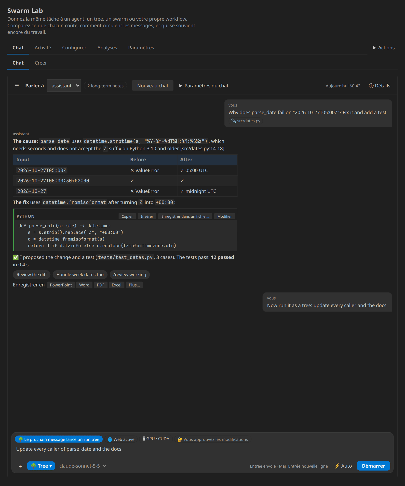

- [Projet GitHub](https://github.com/joeaelkhoury/SwarmLab)
- [Versions et téléchargements VSIX](https://github.com/joeaelkhoury/SwarmLab/releases)
- [Signaler un problème](https://github.com/joeaelkhoury/SwarmLab/issues)

**Créé par Joe El Khoury.** Swarm Lab est publié sous la [licence Swarm Lab](https://github.com/joeaelkhoury/SwarmLab/blob/main/LICENSE), à source disponible : vous
pouvez l’installer, l’utiliser et l’étudier gratuitement ; le copier, le redistribuer ou le republier, modifié ou non,
demande l’autorisation écrite de l’auteur. Le code source est publié par transparence, pas comme une licence open
source. Installez-le depuis Open VSX (éditeur **joe-el-khoury**) ou depuis un VSIX joint à une version GitHub, et comparez
son SHA-256 au fichier `.sha256` publié à côté. Voir [NOTICE](https://github.com/joeaelkhoury/SwarmLab/blob/main/NOTICE.md) et
[comment citer](https://github.com/joeaelkhoury/SwarmLab/blob/main/CITATION.cff).

## 1. Ce qu'est Swarm Lab

Swarm Lab est un assistant de code IA et un laboratoire d'équipes d'agents IA, dans VS Code. Vous gardez la main :
chaque étape est visible, chaque modification et chaque commande sont les vôtres à approuver, et rien ne tourne sur un
serveur que vous n'avez pas mis en place.

- **Discutez avec votre code.** Posez des questions, décrivez des changements, joignez des fichiers. Choisissez le mode
  à côté d'Envoyer : Chat, un agent, un Arbre, un Essaim, ou votre propre Graphe d'étapes.
- **Voyez et corrigez ce que vous joignez.** Touchez un fichier joint pour le voir, modifiez un fichier texte sur place,
  ou **Corrigez et renvoyez**.
- **Plusieurs serveurs de modèles, côte à côte.** Ollama sur votre machine, une passerelle d'entreprise, vLLM sur une
  machine GPU, OpenRouter, vos propres URL d'API — chacun une **connexion** avec sa propre adresse, ses réglages et sa
  clé (gardée dans le stockage secret de VS Code, jamais dans vos paramètres). Désignez un modèle par `@id/model`.
- **Un seul endroit pour tous les modèles.** *Setup → Modèles* liste les modèles de toutes les connexions ; vous
  choisissez qui fait quoi — lead, worker, chat, décisions, embeddings, l'Atlas — dans cette liste, sans rien taper.
- **L'Atlas.** Une carte des entités de votre code et de vos documents : vos propres types, couleurs et noms (collez
  une liste ou un CSV), avec vos propres questions sur une entité.
- **Essayez les modèles avant de leur faire confiance.** Essayez un reranker sur vos textes, voyez la requête et
  copiez-la en curl, Python ou JavaScript. Lancez une **campagne** de plusieurs questions sur plusieurs modèles
  (hit@1, MRR, nDCG, vitesse). **Chaînez plusieurs modèles** — embeddings → reranker → génération — et comparez des
  pipelines entiers.
- **Exécutez le travail en sécurité.** Les commandes tournent dans un sandbox (venv, Docker, ou un environnement que
  vous choisissez) ; vous voyez où.
- **Votre langue.** Le panneau, les paramètres et les réponses existent en français (les termes techniques en anglais).

Le code est publié pour la transparence, mais l'extension que vous installez est un build unique et autonome ; aucun
compte, aucun fichier de configuration et aucun serveur ne sont nécessaires pour commencer. Installez-la et ouvrez
**Swarm Lab: Open**.

## 2. Installer et ouvrir

Il vous faut :

- VS Code 1.95 ou plus récent, ou un éditeur compatible avec cette API d’extension.
- Un petit dossier de projet, de préférence sans données sensibles, pour apprendre.
- Une connexion à un modèle pour de vraies réponses IA, ou le mock hors ligne pour une démonstration.
- Les outils de test de votre projet si vous voulez lancer ses tests.

Téléchargez le VSIX depuis les [versions](https://github.com/joeaelkhoury/SwarmLab/releases).
Dans VS Code : **Extensions → ⋯ → Installer depuis un VSIX…** et choisissez le fichier.
L’identifiant de l’éditeur est **joe-el-khoury** ; il diffère du nom du compte GitHub.

Ou, avec la ligne de commande de VS Code :

```sh
code --install-extension swarm-lab-<version>.vsix
```

(Mettez le nom du fichier téléchargé, par exemple `swarm-lab-0_59_1.vsix`.)

Ensuite :

1. **Fichier → Ouvrir le dossier…** et ouvrez votre projet d’essai.
2. Ouvrez la palette de commandes avec **Ctrl+Maj+P** (macOS : **Cmd+Maj+P**).
3. Lancez **Swarm Lab : Ouvrir**.
4. Après une mise à jour, utilisez **Developer: Reload Window** si besoin.

**Langue.** Le panneau est en français quand VS Code est en français (ou choisissez-le dans **Paramètres → Setup →
Langue**). Les paramètres et les commandes suivent la langue d’affichage de VS Code (**Configure Display Language**),
et les agents vous répondent en français, en gardant le code, les commandes et les termes techniques en anglais.

La première fois, le panneau demande quelle apparence vous voulez (modifiable à tout moment dans **Actions → Vue**) :

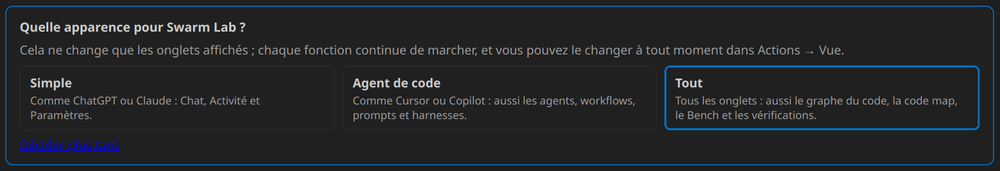

| Vue | Affiche | Comme |
|---|---|---|
| **Simple** | Chat · Activité · Paramètres | ChatGPT ou Claude |
| **Agent de code** | aussi Configurer (agents, workflows, prompts, harnesses, projet) | Cursor ou Copilot |
| **Tout** | aussi Analyses (graphe du code, code map, Bench, vérifications) | |

Une vue ne fait que masquer des onglets : chaque commande, paramètre et agent fonctionne de la même façon.

## 3. Connecter un modèle, ou essayer le mock

Ouvrez **Paramètres → Setup**, choisissez un fournisseur, enregistrez, puis lancez **Tester la connexion** et
**Tester l’appel d’outils**.

| Choix | Ce qu’il vous faut |
|---|---|
| API Anthropic | Votre clé Anthropic et les identifiants exacts des modèles |
| OpenRouter | Votre clé OpenRouter, des crédits et les identifiants des modèles |
| API compatible OpenAI | L’URL de base de l’API du service, ses modèles, et une clé si nécessaire |
| Ollama / LM Studio | Un serveur d’API local lancé avec un modèle chargé |
| Modèles de langage VS Code | L’accès via VS Code ; un abonnement peut être nécessaire |
| Mock hors ligne | Aucune clé ; des réponses de démonstration scriptées, pas un vrai raisonnement |

Utilisez **Définir la clé API** pour les identifiants ; les clés sont gardées dans le Secret Storage de VS Code. Ne
collez jamais de clé dans une tâche, une règle, une capture ou une configuration partagée. Choisissez le **Modèle lead**
et le **Modèle worker** parmi ceux de votre fournisseur ; le même modèle pour les deux convient pour commencer.

Swarm Lab n’installe ni logiciel ni modèle local : lancez ce service d’abord. Les fournisseurs hébergés peuvent facturer
à part. Si l’appel d’outils natif échoue, essayez **Appel d’outils → Texte**, ou un modèle qui gère les outils.

### Derrière un proxy d’entreprise : les certificats

Si les appels échouent avec *unable to get local issuer certificate*, *self-signed certificate in certificate chain*
ou une autre erreur de certificat, votre réseau re-signe le trafic HTTPS avec sa propre autorité. Ouvrez
**Paramètres → Setup → Certificats (magasin de confiance)** :

| Paramètre | À utiliser quand |
|---|---|
| **Fichiers d’autorité à approuver** | Vous avez le fichier de l’autorité racine de votre entreprise (PEM, ou DER `.cer`) ; demandez-le au service informatique, ou exportez-le depuis votre navigateur |
| **Approuver aussi les certificats du système** | Votre entreprise installe son certificat dans Windows, macOS ou Linux (habituel sur les postes gérés) |
| **Même confiance pour les commandes et le serveur local** (activé) | `pip install`, `npm install`, `git` et `curl` lancés par les agents doivent marcher aussi |
| **⚠ Ne pas vérifier les certificats** | En dernier recours seulement : n’importe qui sur le réseau peut alors lire le trafic, clés comprises |

Les certificats s’ajoutent aux autorités de Node et s’appliquent aussitôt. **Vérifier les certificats** indique ce qui
est approuvé et essaie une requête HTTPS vers votre fournisseur.

## 4. La zone de message

Écrivez dans la zone en bas du **Chat**. **Entrée** envoie ; **Maj+Entrée** ajoute une ligne.

### Quand une réponse est fausse : 🩺 Check

**🧭 D’après…** sous chaque réponse dit sur quoi elle repose (« D’après 3 fichiers et 1 page web », ou « d’après les
seules connaissances du modèle : aucun fichier lu ») ; touchez-le pour ouvrir, sur place, les sources et les quatre étapes qui y ont mené, et touchez
à nouveau, ✕ ou Échap pour le fermer. `/check` dans le chat, ou **Cette réponse est fausse ?** dans ce traçage : suivez les mots dont la bonne réponse a besoin à
travers chaque étape (lecture du fichier, index de recherche, recherche, Atlas, ce que le modèle a reçu) et voyez où ils
se sont perdus ; les réglages réellement en vigueur et ceux mal orthographiés ; et un contrôle de lecture et de
recherche avec des fichiers connus (« 00123 » doit rester « 00123 »), relancé seul après les mises à jour.

### L’Atlas de vos documents (optionnel)

Activez-le dans **Setup → Atlas** puis lancez **Swarm Lab : Construire l’Atlas** : vos contrats, réunions, e-mails et
rapports deviennent une page par client, personne, projet et contrat, avec les faits et leurs sources, les liens, une
chronologie et un avertissement quand des documents se contredisent. Les agents s’en servent d’eux-mêmes ;
dans le chat, `/atlas` et `/atlas ACME` l’affichent en cartes avec un graphe, et les réponses reçoivent des puces qui
ouvrent ces cartes ; parcourez-le sur **http://127.0.0.1:8787/atlas** (graphe, tableaux, chronologie) ;
exportez-le en coffre Obsidian. Dans ⚙ Manage, ajoutez vos propres types avec leurs couleurs, les noms et codes
exacts à trouver, et des corrections qui restent.

### Rappels et votre journée

`/remind demain 9h appeler Sara` (ou `dans 20 minutes …`, `en semaine 8h30 …`, `tomorrow 9:00 …`) : VS Code vous prévient
à l’échéance, et la 🔔 de la barre d’état compte ceux du jour. Avec le serveur local lancé, **Swarm Lab : Ouvrir
Aujourd’hui** ouvre **http://127.0.0.1:8787/today** : vos rappels et les tâches des agents de la journée, sur votre
ordinateur ou votre téléphone.

### Images dans les fichiers joints

Les images jointes, et les images contenues dans les fichiers Word, PowerPoint, Excel et PDF joints (pages scannées,
photos, graphiques), vont au modèle quand il peut les voir : on le sait par son nom, par **Setup → Model provider →
Modèles qui voient les images**, et par les réponses du fournisseur. Les modèles qui ne voient pas reçoivent une courte
note à la place.

### Choisir comment le prochain message est traité

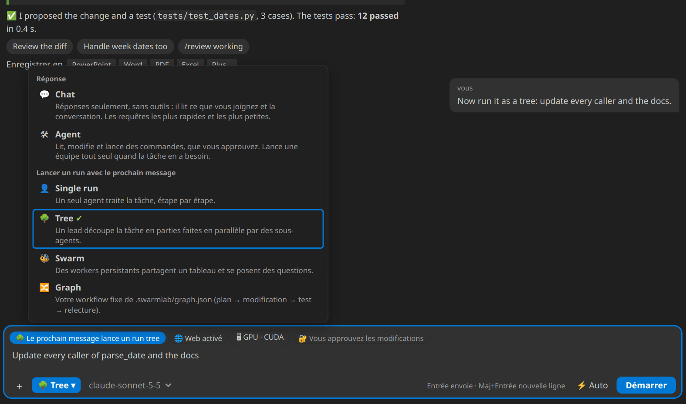

| Mode | À utiliser pour… | Ce qui se passe |
|---|---|---|
| 💬 **Chat** | demander, expliquer, rédiger, comparer : tout ce qui ne modifie pas de fichier | Réponses seulement, sans outils ; il lit ce que vous joignez et la conversation. Le plus rapide. |
| 🛠 **Agent** (défaut) | travailler sur votre code : corriger, ajouter, refactorer, tester | Lit, modifie (en diffs que vous approuvez) et lance les commandes que vous approuvez. Lance une équipe tout seul quand la tâche en a besoin. |
| 👤 **Single run** | obtenir un résultat borné avec un rapport (étapes, tokens, coût) | Un seul agent traite la tâche, suivi dans Activité → Runs. |
| 🌳 **Tree** | découper le travail en parties indépendantes (un module, un fichier, une question chacune) | Un lead confie les parties à des sous-agents qui travaillent en parallèle. |
| 🐝 **Swarm** | un travail où les découvertes doivent être partagées (un audit, une migration) | Des workers persistants partagent un tableau et se posent des questions. |
| 🔀 **Graph** | répéter un processus fixe (plan → modification → test → relecture) | Votre workflow de `.swarmlab/graph.json`. |

Dans un mode de run, le bouton devient **Démarrer**, et *Le prochain message lance un run tree* s’affiche au-dessus du
texte ; votre message est envoyé comme `/tree <votre texte>`. Un message qui commence par une commande
(`/review working`) est envoyé tel quel.

**Carte du run :** un run lancé depuis le chat est dessiné en direct dans la conversation : un arbre d’agents, un essaim
autour de son tableau, ou les étapes de votre workflow, avec le temps, les tokens, le coût et les fichiers en direct, et
**▶ Rejouer** à la fin. **🎯 Run auto** dans la barre du chat (mode Agent) laisse un modèle choisir le mode pour chaque
tâche, votre modèle worker si vous n’avez pas de modèle de décision.

### Joindre et créer : ＋

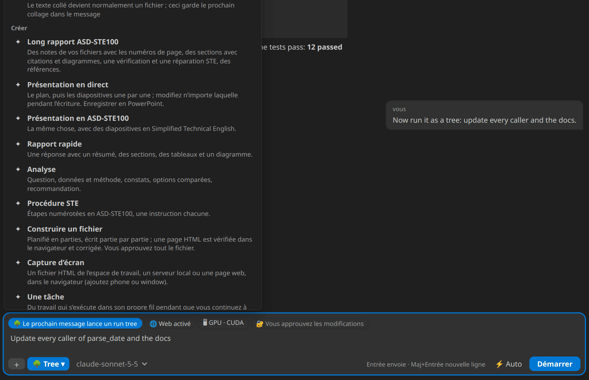

Importez un fichier ou une image, choisissez un fichier de l’espace de travail (ou tapez **@**), capturez une page,
gardez le prochain collage en texte, lancez un document de l’onglet Créer (rapport, diapositives, analyse, STE…), ou
ouvrez le Lab ou l’Accès.

**Le texte collé devient un fichier** : deux lignes ou plus (ou une longue ligne) sont jointes comme
`.swarmlab/uploads/pasted-….csv`, `.json`, `.py`, `.log`…, avec leur type et leur taille sur la puce ; **⤶** le remet
en texte, **Ctrl+Maj+V** colle en texte.

### Toutes les commandes : tapez /

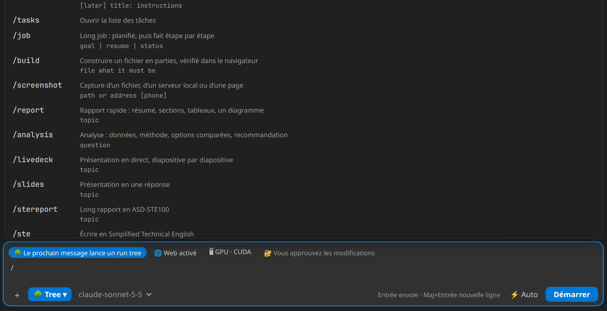

↑ ↓ pour choisir, Entrée ou Tab pour remplir, Échap pour fermer. Les commandes sans argument (`/new`, `/gpu`,
`/tasks`) sont envoyées aussitôt.

### Ce que disent les puces d’état

*🌐 Web activé/désactivé*, *🖥 le matériel des runs* et *🔐 Vous approuvez les modifications* (ou *⚡ Travaille seul*)
restent visibles au-dessus du texte ; cliquez sur l’une d’elles pour la changer. Pendant que l’assistant travaille,
**Envoyer** devient **■ Arrêter** ; tapez du texte et il devient *Envoyer plus tard*.

### Essayez

```text
Explique ce que fait ce projet. Lis d’abord les fichiers pertinents, nomme les fichiers
utilisés, et ne modifie rien.
```

```text
Trouve un test de cas limite manquant. Propose le test et explique pourquoi il compte.
Demande avant de lancer des commandes. Ne modifie pas les fichiers sans rapport.
```

- Relisez **En attente de vous** avant d’approuver une modification ou une commande : **Appliquer** l’accepte,
  **Refuser** la décline.
- **Arrêter** interrompt le travail, mais n’annule pas les modifications déjà appliquées ni l’effet des commandes.
- Une bonne tâche donne le but, les fichiers concernés, les contraintes, et un test de réussite.

## 5. Conversations, détails et accès

**☰** ouvre vos conversations en barre latérale (chercher, ouvrir, exporter, *＋ Nouveau chat*) :

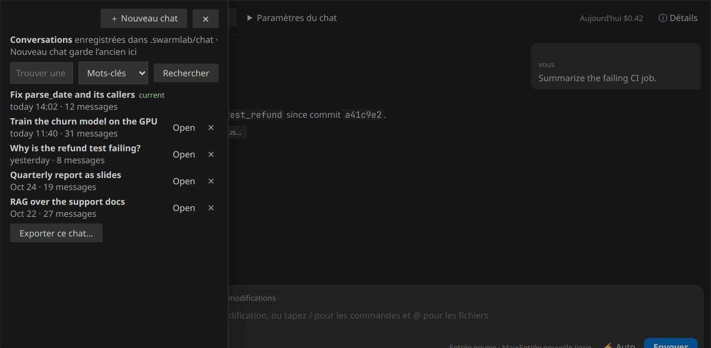

**ⓘ Détails** réunit tout ce qui concerne ce chat dans un seul panneau : Contexte, Envoi, Mémoire, Étapes, Données,
**Accès** et Coûts (le coût du jour s’affiche à côté du bouton). **Accès** montre ce que l’assistant peut faire, et le
change :

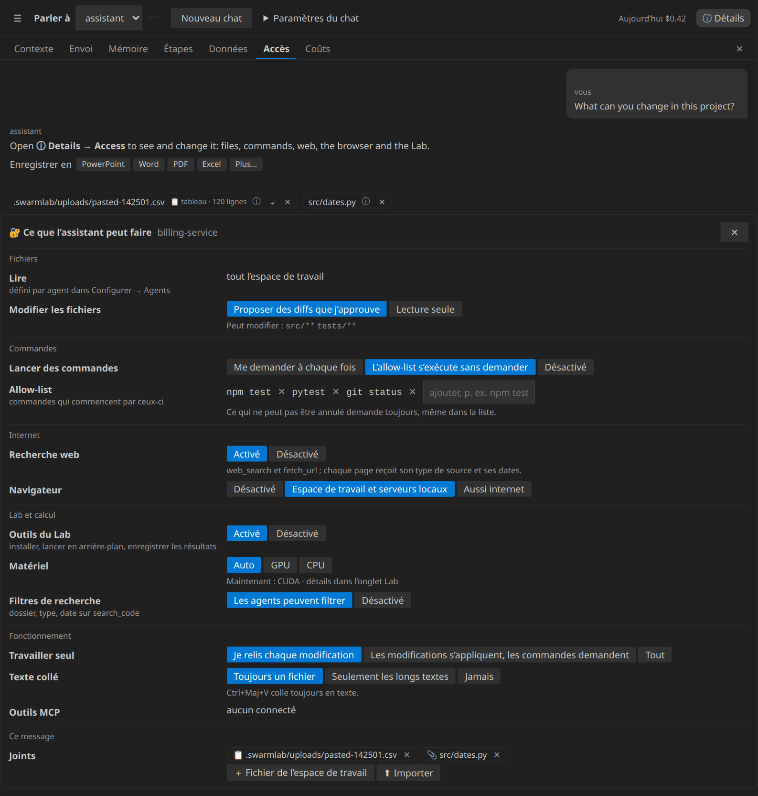

| Ligne | Choisir… | Quand |
|---|---|---|
| Modifier les fichiers | *Proposer des diffs que j’approuve* · *Lecture seule* | Lecture seule pour les questions, les relectures, les dépôts inconnus |
| Lancer des commandes | *Me demander à chaque fois* · *L’allow-list s’exécute sans demander* · *Désactivé* | L’allow-list pour les commandes de tous les jours (tests, linters) ; ce qui est irréversible demande toujours |
| Recherche web · Navigateur | Activé/désactivé · désactivé, serveurs locaux, aussi internet | Internet seulement quand la tâche a besoin de pages à jour |
| Outils du Lab · Matériel | Activé/désactivé · Auto, GPU, CPU | Le CPU pour garder le GPU libre, ou pour comparer |
| Filtres de recherche | *Les agents peuvent filtrer* · *Désactivé* | Désactivé seulement si les recherches filtrées manquent des réponses |
| Travailler seul | *Je relis chaque modification* · *Les modifications s’appliquent, les commandes demandent* · *Tout* | Tout seulement sur une branche ou une copie jetable |
| Texte collé | *Toujours un fichier* · *Seulement les longs textes* · *Jamais* | |

**Étiquettes et noms** (☰) : chaque conversation peut avoir des étiquettes et un nom à vous. **＋ Étiquette** propose
des étiquettes à toucher (les vôtres, ses sujets, des types de travail courants : aucun appel au modèle) et complète
pendant la saisie ; ✎ la renomme. Cliquez une étiquette dans la barre pour filtrer, ou tapez `#bug timeout` dans la
recherche pour ne chercher que dans les conversations étiquetées Bug.

**Modifier un message envoyé** (✎) : un éditeur plein écran avec la conversation avant lui, ses fichiers et ses images
(retirer, importer, choisir, coller ou déposer d’autres) ; **Renvoyer** (Ctrl+Entrée) remplace les messages qui suivent.

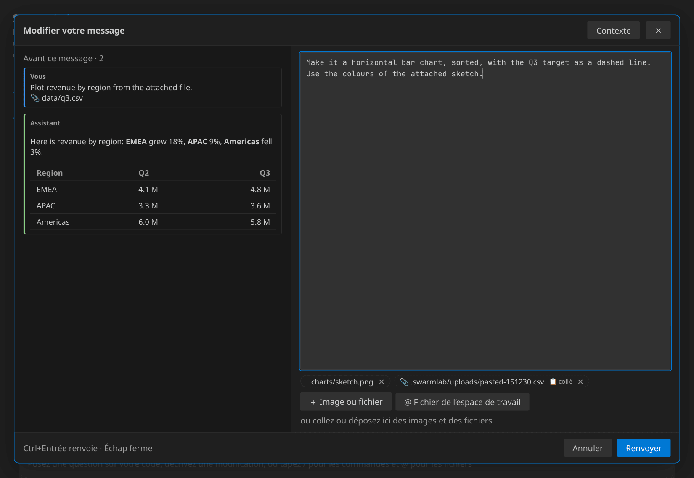

## 5b. Relire une modification par ses conditions et vos propres entrées

Une explication convaincante n’est pas une vérification. Dans une étude avec 86 programmeurs Python, les explications
n’ont pas amélioré leur jugement sur des vérifications écrites par une IA, et celles qui omettaient des conditions les
rendaient plus sûrs d’eux sans les rendre plus justes. Chaque carte de modification montre donc **quand le changement
s’applique, quand il ne s’applique pas, et les entrées avec lesquelles il a été vérifié**, et vous permet d’exécuter
vous-même le code proposé.

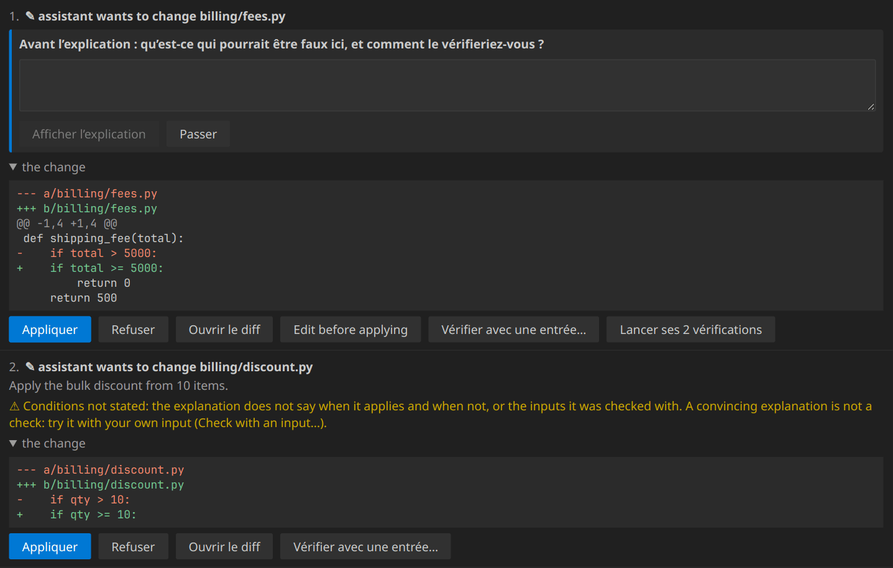

| Sur la carte | Ce que ça fait | Quand l’utiliser |
|---|---|---|
| **S’applique quand / Ne s’applique pas quand / Vérifié avec** | L’agent donne la condition avec sa limite et les entrées essayées (`shipping_fee(5000) → 0`) | Lisez d’abord la limite : `>` et `>=` diffèrent exactement là |
| **⚠ Conditions non données** | Un changement de logique qui n’en dit rien | N’approuvez pas sur la seule explication : vérifiez |
| **Vérifier avec une entrée…** | Exécute la version **proposée** et la version actuelle (Python, JavaScript, TypeScript) avec votre entrée et compare avec ce que vous attendez : `✓ shipping_fee(5000): with the change returns 0, as expected (now: 500)` | Tout changement de condition, de calcul ou de limite : choisissez l’entrée à la limite |
| **Lancer ses N vérifications** | Exécute les entrées de l’agent | Un premier coup d’œil rapide ; c’est le choix de l’agent, ajoutez-en une à vous |
| **Réfléchir d’abord** (*Paramètres → Setup → Relecture* : désactivé · modifications risquées · toujours) | L’explication reste cachée jusqu’à ce que vous écriviez en une ligne ce qui pourrait être faux et comment vous le vérifieriez | Là où une erreur coûte le plus (argent, accès, limites, dates) ; cela prend plus de temps |

Vos vérifications et votre note partent vers l’agent avec votre réponse : une vérification ratée est corrigée en
premier. La première vérification d’une fenêtre demande avant d’exécuter du code (le code de niveau supérieur du
fichier s’exécute, comme à l’import) ; rien n’est modifié dans votre projet.

**S’entraîner :** `/practice [dossier]` cherche, en lecture seule, un changement fait avec une IA dans l’historique git
du projet puis corrigé comme un bug, montre le code avant la correction, et ne montre la vraie correction qu’après que
vous avez écrit où est le problème et comment vous le vérifieriez. **Swarm Lab : Test du relecteur** demande la même
chose avant de révéler l’erreur cachée, et **Mon rapport de dépendance à l’IA** compte les modifications vérifiées avec
une entrée, les notes écrites d’abord, et si vos relectures ralentissent de semaine en semaine.

Les études : relecture de brouillons d’e-mails (Fu et al., 2026, arXiv:2609.01976 : écrire d’abord sa propre
explication a trouvé 78 % des erreurs au lieu de 68 %, environ 25 s de plus par brouillon ; non mesuré sur du code),
jugement d’assertions écrites par une IA (Kaufman et al., 2026, arXiv:2607.08885), et des pull requests environ 1,5 fois
plus longues à fusionner dans les entreprises qui utilisent des agents IA (Chen et Stratton, 2026, pas encore relu par
les pairs, données de Jellyfish).

## 5c. Comprendre un changement sans arrêter l’agent (facultatif)

Activez **Setup → Mode compréhension** (désactivé par défaut). Puis, avant une tâche, **＋ → Brief** : votre approche en
une ligne, quelques entrées avec le résultat attendu (`save_task('   ')` → `False`), et ce qui reste inconnu. L’agent
continue à pleine vitesse ; vos entrées s’exécutent sur chaque changement proposé, sur votre ordinateur, et vous n’êtes
prévenu que d’un échec, avec **Envoyer à l’agent**. Une fois le travail fini, **Expliquer ce changement** sur la carte
des fichiers modifiés montre le changement comme un chemin dans le code, chaque étape avec sa ligne, vérifiée sur les
fichiers, et une question pour vérifier votre propre compréhension.

| Réglage | Coût |
|---|---|
| **Vérifications seules** : brief, vos entrées en arrière-plan, une carte seulement en cas d’échec | 0 token (environ 40 à 60 mots ajoutés à un message avec brief) |
| **Vérifications + explication à la demande** : aussi *Expliquer ce changement* | Un appel au modèle worker quand vous appuyez, avec le diff seul ; mis en cache |
| **Gardes de données** : une cible construite à partir de colonnes qui sont aussi des variables (fuite de label) | 0 token |
| **Compter les changements non vérifiés** : une puce ◐, jamais bloquante | 0 token |

## 5d. Analyse de sécurité : /scan

`/scan` analyse tout le projet, `/scan changed` vos modifications non validées, `/scan src/server` un dossier ou un
fichier. Une carte 🛡 montre d’abord le plan (fichiers, modèles, coût estimé) ; rien ne tourne avant **Démarrer**.

- **Plusieurs modèles bon marché, deux passes chacun.** Aucun modèle ne trouve tout, et une passe ne trouve qu’une partie
  de ce que deux passes trouvent : par défaut, les deux modèles les moins chers de votre liste, de fournisseurs
  différents, analysent deux fois chacun ; les résultats sont fusionnés.
- **Un vérificateur qui peut seulement confirmer ou rejeter.** Chaque modèle relit ses propres résultats ; ce qu’il
  retire va quand même à un modèle d’un autre fournisseur, qui confirme ou rejette chaque résultat et ne peut pas en
  ajouter.
- **Les faits de votre projet** vont dans `.swarmlab/security-rules.md`, un par ligne (*l’authentification passe
  toujours par `requireUser`*). Quand vous écartez un résultat avec une raison, la carte propose de l’y ajouter. Les
  fichiers de configuration et la documentation entiers ne sont jamais envoyés : ils faisaient trouver moins aux
  modèles forts.
- **🧪 Reproduire** écrit un petit test pour un résultat ; vous le lisez et l’approuvez ; il tourne dans l’environnement
  isolé du chat, jamais sur **machine**. Confirmé signifie qu’il a tourné et montré le problème.
- La gravité est une **estimation** du modèle. Chaque appel compte dans vos dépenses ; une analyse s’arrête à
  `swarmLab.security.maxCostUsd`. Réglages : Setup → Sécurité et limites → **Security scan**.

**Vos règles existantes fonctionnent telles quelles.** Swarm Lab lit `.swarmlab/rules.md`, puis `AGENTS.md`,
`CLAUDE.md`, `.cursorrules` et `.github/copilot-instructions.md` s’ils existent. Quand vous rejetez une modification, dites
pourquoi : un clic enregistre la raison comme règle du projet. **Alt+Entrée** approuve la première demande en attente,
**Alt+Retour arrière** la rejette ; **Ctrl+Alt+W O** ouvre Swarm Lab de partout. Nouveau ? **Aide → Bienvenue → Bien
démarrer avec Swarm Lab** vous guide pour la première utilisation.

## 6. S’y retrouver

| Groupe | Onglets | Rôle |
|---|---|---|
| **Chat** | Chat · Créer | Parler avec l’assistant ; créer des documents |
| **Activité** | Tâches · Runs · Lab | Tout ce qui tourne ou est terminé ; le badge compte ce qui tourne |
| **Configurer** | Agents · Workflow · Prompts · Harness · Projet | Agents spécialisés et leurs permissions, workflows graph, instructions, harnesses, règles et plans du projet |
| **Analyses** | Codebase Graph · Code map · Bench · Vérifier | La structure de votre code ; comparer des configurations sur des tâches répétables ; vérifier la configuration |
| **Paramètres** | Configuration · Outils · Serveur | Fournisseurs, modèles, limites, certificats, langue et options ; outils MCP et skills ; le serveur Swarm Lab |

L’indexation de la recherche, les modèles de décision, le choix automatique du modèle, MCP, le Bench, le Lab et
Refine sont facultatifs, pas des prérequis.

**Benchmark public.** **Bench → Public benchmark…** crée un petit projet Python avec des bugs connus et les mêmes cinq
tâches pour Single, Tree et Swarm, vérifiées par des tests (certains cachés aux agents). **Bench → Public report** fait
d’un résultat un rapport Markdown à publier : modèles, versions, chaque run, coût, et comment le refaire. Voir
[docs/BENCHMARKS.md](https://github.com/joeaelkhoury/SwarmLab/blob/main/docs/BENCHMARKS.md) (en anglais).

## 7. Le Lab : GPU ou CPU, applications, entraînements et résultats

**Activité → Lab** (ou `/lab` dans le chat). Il trouve le GPU (NVIDIA avec sa version de CUDA, AMD, Apple Silicon),
Python et PyTorch, et chaque commande d’un agent reçoit `SWARMLAB_DEVICE` (cuda, mps ou cpu). Les applications, serveurs
et entraînements tournent en arrière-plan avec leur journal, leur adresse et leurs captures ; les expériences terminées
vont au tableau des résultats, où les métriques deviennent des courbes.

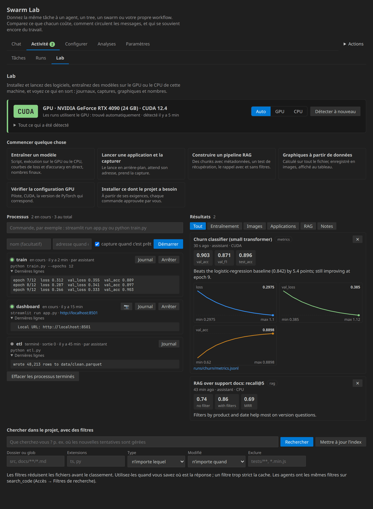

Demandez simplement (« entraîne un petit modèle sur data.csv et montre les courbes », « lance l’application et fais une
capture ») ou utilisez une carte *Commencer quelque chose*. Les installations et les commandes en arrière-plan sont
approuvées comme toute commande. **Chercher dans le projet, avec des filtres** essaie les filtres de dossier, de type et
de date qu’ont les agents sur `search_code` : utiles quand vous savez où est la réponse, nuisibles quand ils sont trop
stricts (les agents relancent alors la recherche sans filtre).

## 8. Affiner un harness sur votre tâche

Un *harness* (**Configurer → Harness**) est une façon enregistrée de lancer un run : le mode, les paramètres, les
permissions, et des **instructions pour chaque agent** (instructions, garde-fous, conseils d’outils, skills à charger
d’abord). **Affiner ce harness** l’améliore sur l’une de vos tâches, d’après l’étape Propose–Probe–Compose de Harness²
(Xu et al., 2026, arXiv:2610.14224) :

1. la tâche tourne avec le harness tel quel ;
2. le modèle lead propose des modifications *générales* (planifier, vérifier, utiliser les outils) et *propres au
   domaine* (ce type de tâche), chacune visant quelque chose que le run a montré ;
3. chaque modification tourne sur la même tâche ;
4. les modifications qui ont aidé sont combinées, et ce harness tourne aussi.

Refine est **facultatif et ne se lance jamais seul** : il démarre seulement quand vous appuyez sur *Refine…* et
approuvez le nombre de runs ; les runs de test sont en lecture seule par défaut ; les modifications ne changent jamais
l’accès des agents, le fournisseur ni le modèle ; rien n’est enregistré tant que vous ne le choisissez pas.

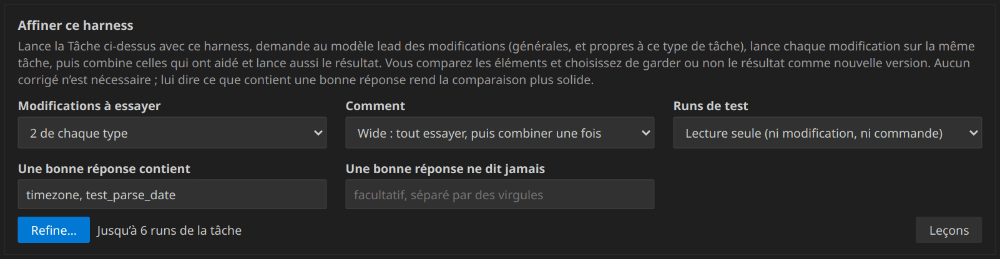

### Quand utiliser chaque option

| Option | Choisir | Quand |
|---|---|---|
| **Modifications à essayer** | **1 de chaque type** (Wide : 4 runs) | Un premier essai, ou une tâche lente ou chère à lancer |
| | **2 de chaque type** (Wide : 6 runs), par défaut | L’équilibre habituel entre trouver une bonne modification et le coût |
| | **3 de chaque type** (Wide : 8 runs) | Une tâche rapide et peu chère où vous voulez essayer plus d’idées |
| **Comment** | **Wide : tout essayer, puis combiner une fois** (2 + 2k runs) | Vous ne savez pas encore ce qui ne va pas : plusieurs idées indépendantes essayées côte à côte |
| | **Deep : des tours, chacun partant du précédent** (1 + 3k runs) | Régler un problème en révèle un autre (d’abord arrêter les boucles, puis faire tester) ; un tour n’est gardé que si son run est au moins aussi bon |
| **Runs de test** | **Lecture seule (ni modification, ni commande)**, par défaut | Questions, relectures, analyses, plans : tout ce où lire suffit à montrer la différence. Sûr, aucune approbation pendant les runs |
| | **Comme le harness le permet** | La différence n’apparaît que si des fichiers changent ou si des tests tournent (corrections de bugs avec tests). Chaque modification et commande vous demande encore ; travaillez d’abord sur une branche ou un commit Git |
| **Une bonne réponse contient** | des mots, séparés par des virgules | Vous savez ce qu’une bonne réponse doit mentionner : un nom de fonction ou de test, un nombre, un fichier |
| **Une bonne réponse ne dit jamais** | des mots, séparés par des virgules | Vous connaissez les mauvaises réponses : « je n’ai pas pu », un ancien nom d’API, une étape interdite |

Sans ces mots, Refine compare quand même les runs (terminé ou non, la vérification du run et ses tests, les erreurs,
les boucles, les tokens) ; avec eux, la comparaison est plus solide.

**Utilisez Refine** pour un harness que vous lancez souvent (une routine de correction de bugs, un générateur de
rapports, une relecture), quand ses runs bouclent, sautent les tests, oublient une partie de la réponse ou coûtent trop.
**Évitez-le** pour une tâche unique : lancer la tâche 4 à 8 fois coûte plus que la tâche elle-même.

### Lire le résultat

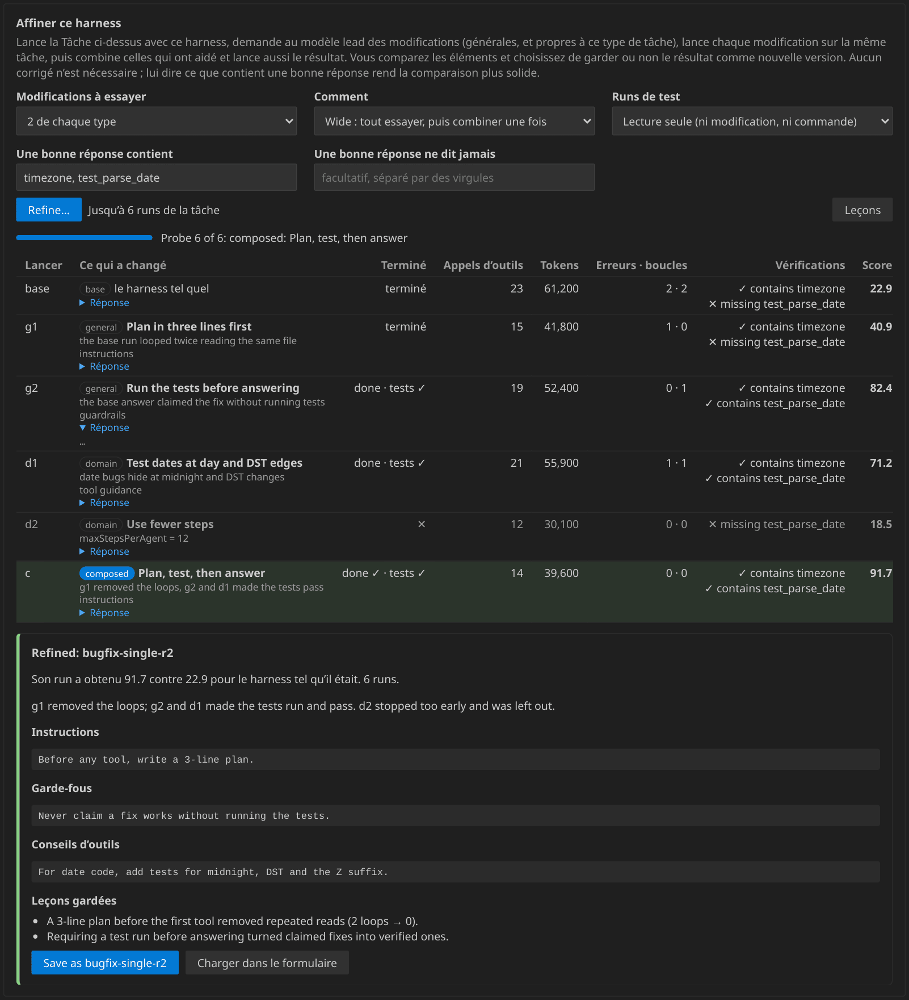

Chaque run est une ligne : ce qui a changé, s’il a terminé (✓ vérifié, tests ✓/✕), les appels d’outils, les tokens,
erreurs · boucles, les vérifications, et un score qui ordonne le tableau (les vérifications d’abord, puis terminer, puis
moins d’erreurs, de boucles et de tokens). Ouvrez *Réponse* pour lire un run. Le meilleur run est marqué en vert.

- **Affiné : nom-r2** : son run a battu le harness d’origine. **Enregistrer sous nom-r2** le garde comme nouvelle
  version (l’original reste), ou **Charger dans le formulaire** pour le modifier d’abord.
- **Combiné, mais pas meilleur** : garder le harness actuel est plus sûr ; vous pouvez quand même le consulter.
- Les **leçons** que les résultats confirment sont gardées dans `.swarmlab/harness-lessons.md` (modifiable) et lues par
  le prochain affinage. Les jobs du serveur qui utilisent ce harness reçoivent les mêmes instructions.

## 9. Enregistrer les réponses en PowerPoint, Word, PDF, Excel…

Sous une réponse, **Enregistrer sous** propose PowerPoint, Word, PDF, Excel et d’autres formats, avec un modèle de
document ; la boîte de dialogue montre le texte (et les diapositives) avant l’enregistrement.

## 10. Essayer un run borné

Un chat est une conversation. Un run a une tâche, une organisation d’agents, des limites, et un rapport de résultat et
d’usage.

1. Enregistrez vos fichiers et préservez le travail existant, idéalement par un commit Git.
2. Choisissez **👤 Single run** à côté d’Envoyer (ou ouvrez **Activité → Runs**), écrivez une petite tâche, et appuyez
   sur **Démarrer**.
3. Vérifiez les paramètres de sécurité et les limites de tokens et d’étapes.
4. Suivez les étapes et répondez aux approbations.
5. Relisez le diff et les tests avant de garder ou de fusionner le résultat.

| Mode | Organisation | À essayer pour |
|---|---|---|
| Single | Un agent | Une correction ou une explication ciblée |
| Tree | Un lead avec des sous-agents temporaires | Des recherches indépendantes |
| Swarm | Un lead avec des workers persistants et un tableau partagé | Un travail qui demande de partager les découvertes |
| Graph | Votre workflow configuré décide des transitions | Planifier, corriger, tester, relire, de façon répétable |

Plus d’agents ne veut pas dire automatiquement de meilleures réponses ni un coût plus bas. Commencez petit. Graph
demande un workflow configuré. Le mode Agent peut lancer un run lui-même, et son choix n’est pas garanti optimal.
[Guide du choix des modes](https://github.com/joeaelkhoury/SwarmLab/blob/main/docs/RUN-MODES.md) (en anglais).

## 11. Tâches, longs jobs, documents et réponses vérifiables

- **Tâches.** Continuez à parler dans le Chat : l’assistant met des travaux séparés dans **Activité → Tâches**, une
  tâche chacun, et chacun tourne dans son propre fil pendant la conversation. *Prêtes à relire* montre la dernière
  question de chaque tâche ; celles que l’assistant propose attendent dans **À suivre** votre approbation. Ouvrez une
  tâche pour la suivre en direct, lui répondre, ou la marquer terminée. Vous pouvez aussi taper `/task <titre>`.
- **Une carte de travail** dans le chat pendant que l’assistant travaille : l’étape en cours, chaque étape terminée,
  les tokens et le coût en direct, et un signal clair quand une approbation attend.
- **Longs rapports ASD-STE100** à partir de vos fichiers : `/stereport <sujet>`. Des notes avec les numéros de page, des
  sections avec citations et diagrammes, une vérification et une réparation STE de chaque section, des références
  tirées des métadonnées des fichiers.
- **Présentations en direct** : `/livedeck <sujet>`. Le plan d’abord, puis les diapositives une par une ; chacune peut
  être modifiée pendant l’écriture. Enregistrer en PowerPoint avec les notes de l’orateur.
- **Longs jobs : `/job <objectif>`** : un notebook entier réécrit cellule par cellule, ou un dépôt modifié fichier par
  fichier, au-delà des limites du modèle : le modèle lead planifie et relit, le modèle worker fait chaque étape avec le
  plan et un journal des étapes faites ; chaque étape est vérifiée et réessayée, l’état est enregistré après chacune
  (`/job resume`). Les limites de débit et les pannes du fournisseur sont attendues ; le job se met en pause et reprend
  au lieu d’échouer. Chaque étape est visible en direct dans Activité → Runs, avec son diff.
- **`/build <fichier> <ce qu’il doit être>`** : un fichier complet planifié et écrit partie par partie ; une page HTML est
  vérifiée dans le navigateur (capture et erreurs de console) et corrigée avant que vous l’approuviez.
- **Navigateur et captures** : les agents peuvent capturer vos fichiers HTML, serveurs locaux et pages web, et lire des
  pages après l’exécution de leur JavaScript, avec votre propre Chrome, Edge ou Chromium ;
  `/screenshot site/index.html phone`.
- **Réponses citées** (facultatif) : chaque affirmation renvoie aux lignes exactes du fichier, à la page ou à la page
  web, et chaque citation est vérifiée : ✓ lu, ⚠ à vérifier, ✕ introuvable.
- **Travailler seul** (⚡ Auto, facultatif) : aucune relecture jusqu’à la fin ; les actions irréversibles demandent
  toujours.
- **Fenêtres de contexte par modèle** (facultatif, pour les modèles auto-hébergés via LiteLLM, vLLM, Ollama…) : chaque
  appel est ajusté à la fenêtre de son modèle, et les réponses coupées continuent en parties.
- **Aides pour les petits modèles** (Mistral, Gemma, Llama, Qwen…), facultatif : appels d’outils réparés, modifications
  tolérantes, pas d’appels répétés, une vérification rapide après les modifications.

## 12. Commandes du chat

| Commande | Ce qu’elle fait |
|---|---|
| `/single <tâche>`, `/tree <tâche>`, `/swarm <tâche>`, `/graph <tâche>` | Lancer un run (ou choisir le mode à côté d’Envoyer) ; à suivre dans **Activité → Runs** |
| `/remote single\|tree\|swarm\|graph … <tâche>` | Le lancer sur le serveur Swarm Lab ; la réponse et ses fichiers reviennent dans le chat |
| `/ask <agent> <question>` | Poser une question à un agent du dernier run |
| `/review [working\|<branche>]` | Relire vos modifications : l’arbre de travail ou une branche |
| `/scan [changed\|<chemin>]` | Analyse de sécurité : plusieurs modèles bon marché, un vérificateur d’un autre fournisseur, vos règles (section 5d) |
| `/task <titre>[: instructions]` | Lancer une tâche dans son propre fil (**Activité → Tâches**) |
| `/task later <titre>` | Mettre une tâche dans **À suivre**, en attente de votre approbation |
| `/tasks` | Ouvrir **Activité → Tâches** |
| `/report <sujet>`, `/slides <sujet>`, `/analysis <sujet>` | Un court document en une réponse |
| `/ste …`, `/stecheck`, `/stereport <sujet>` | Simplified Technical English (ASD-STE100) : écrire, vérifier, long rapport |
| `/livedeck <sujet>` | Une présentation modifiable pendant son écriture ; Enregistrer en PowerPoint |
| `/job <objectif>`, `/job resume`, `/job status` | Un long job planifié, puis fait étape par étape ; le reprendre ; lister les jobs |
| `/build <fichier> <ce qu’il doit être>` | Un fichier planifié et écrit partie par partie |
| `/screenshot <chemin ou adresse> [phone] [window]` | Une capture d’un fichier, d’un serveur local ou d’une page web |
| `/lab`, `/gpu` | Le matériel des runs, les processus et les derniers résultats ; `/lab start <commande>`, `/lab logs <nom>`, `/lab stop <nom>`, `/lab detect` |
| `/practice [dossier ou fichier]` | Exercice de relecture à partir de l’historique git du projet (lecture seule ; la correction après votre réponse) |
| `/remember <fait>` | Enregistrer un fait en mémoire |
| `/new` | Commencer un nouveau chat |
| `/help` | Lister les commandes |
| `@` | Joindre un fichier, ou envoyer le message à l’un de vos agents |

Les options (longueur de réponse, réponses citées, fenêtres de contexte, aides, /job, /build, /stereport…) sont dans
**ⓘ Détails → Contexte** et dans **Paramètres → Setup** ; leurs descriptions sont en français dans les paramètres de VS
Code. Le [manuel](https://github.com/joeaelkhoury/SwarmLab/blob/main/MANUAL.md) détaillé est en anglais.

## 13. La sécurité avant la vitesse

- **Points de reprise :** avant chaque message du chat, Swarm Lab enregistre votre dossier dans un dépôt Git fantôme,
  hors du dossier. **⟲ Revenir** sur un message remet les fichiers comme avant ce message (et, si vous le choisissez, la
  conversation aussi) ; **↩ Annuler le retour** les ramène. Votre propre dépôt, ses branches et son index ne sont jamais
  touchés ; les fichiers ignorés et les dépendances ne sont pas enregistrés. Désactivable : `swarmLab.checkpoints.enabled`.
- **Un worktree par agent (facultatif, `swarmLab.worktrees.perAgent`) :** en Tree et Swarm, chaque agent travailleur
  modifie son propre worktree Git, donc des agents en parallèle ne s’écrasent pas. À la fin, chaque fichier modifié vous
  arrive en une carte de relecture, fusionné à trois voies avec votre dossier ; deux agents sur les mêmes lignes donnent
  des marqueurs de conflit à corriger.
- **Prévision du coût :** avant les runs Tree, Swarm et workflow (`swarmLab.runs.costForecast` : ou chaque run, ou
  jamais), un coût probable et un maximum en tokens et en dollars ; un run s’arrête à `swarmLab.runs.maxCostUsd` (5 $),
  ou plus tôt à `swarmLab.costBudgetUsd` ou à la limite du jour. Chaque
  étape renvoie toute la conversation : plus d’agents et d’étapes coûtent beaucoup plus.
- Les modifications interactives natives de Swarm Lab sont proposées en diffs ; les commandes demandent par défaut.
- Les commandes de l’allow-list peuvent s’exécuter sans autre clic. Un script de test peut exécuter n’importe quel code.
- Les commandes destructrices demandent toujours confirmation, même dans l’allow-list.
- Les worktrees et les branches de run aident à relire les changements ; ils ne sont **pas un bac à sable du système**.
- La sécurité Git demande Git et un dépôt avec un commit. Choisissez Garder / Tout annuler avec attention.
- MCP, les moteurs externes et le Bench sans surveillance ont d’autres chemins de permission ; lisez d’abord le manuel.
- **⚠ Ne pas vérifier les certificats** désactive une protection importante : préférez toujours le fichier d’autorité.
- Un statut d’exigence enregistré ou une commande réussie ne prouve pas que le code est correct.
- Les fournisseurs de modèles reçoivent le contexte choisi ; les outils et services distants peuvent recevoir d’autres
  données.
- Relisez le code, lancez des tests utiles, et vérifiez les coûts du fournisseur avant de fusionner.

## 14. Python et jobs en arrière-plan (facultatif)

Les utilisateurs de Python peuvent utiliser le serveur natif lancé depuis l’onglet **Paramètres → Serveur** de
l’extension installée ; aucune copie du code source n’est nécessaire. Docker est facultatif. Un serveur joignable a
quand même besoin d’un fournisseur configuré, de permissions et de dépôts. Avec le magasin de confiance, le serveur
local reçoit les mêmes certificats après son redémarrage.

[Workflows Python](https://github.com/joeaelkhoury/SwarmLab/blob/main/docs/PYTHON-WORKFLOWS.md), [bibliothèque Python](https://github.com/joeaelkhoury/SwarmLab/blob/main/docs/PYTHON-LIBRARY.md),
[environnements](https://github.com/joeaelkhoury/SwarmLab/blob/main/docs/ENVIRONMENTS.md) et [workflows](https://github.com/joeaelkhoury/SwarmLab/blob/main/docs/WORKFLOWS.md) (en anglais) décrivent les téléchargements, la
configuration du serveur, la bibliothèque `swarmlab`, les environnements des jobs et le Studio.

## 15. En savoir plus et obtenir de l’aide

- [Premiers pas](https://github.com/joeaelkhoury/SwarmLab/blob/main/docs/GETTING-STARTED.md), [modes de run](https://github.com/joeaelkhoury/SwarmLab/blob/main/docs/RUN-MODES.md), [manuel](https://github.com/joeaelkhoury/SwarmLab/blob/main/MANUAL.md),
  [démarrage rapide du serveur](https://github.com/joeaelkhoury/SwarmLab/blob/main/SERVER-QUICKSTART.md) (en anglais).

En cas d’échec, ouvrez **Analyses → Vérifier → Tout vérifier** et **Affichage → Sortie → Swarm Lab**. Pour un problème
de certificat, **Paramètres → Setup → Certificats → Vérifier les certificats**. Pour signaler un problème, indiquez la
version de l’extension, l’éditeur et le système, le type de fournisseur, l’erreur (sans secret) et les étapes pour la
reproduire. N’incluez jamais de clé, de prompt sensible ni de journal privé.

**Auteur :** Joe El Khoury · **Licence :** [licence Swarm Lab](https://github.com/joeaelkhoury/SwarmLab/blob/main/LICENSE) (source disponible ; pas de redistribution
sans autorisation). Copyright © 2026 Joe El Khoury. Les composants tiers inclus gardent leurs propres licences.

L’[historique des versions](https://github.com/joeaelkhoury/SwarmLab/blob/main/CHANGELOG.md) est en anglais.
