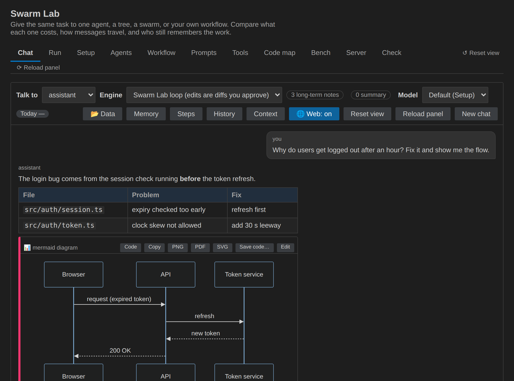
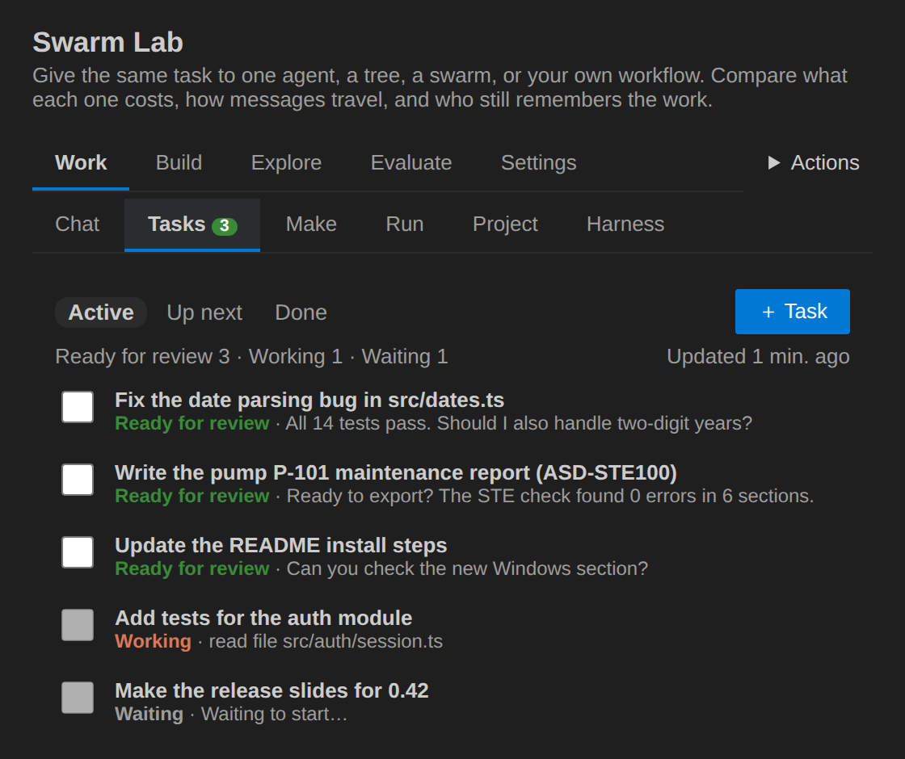

# Swarm Lab

**An AI coding assistant and teams of agents inside VS Code—with visible steps, reviewable edits, and command approvals.**

Start with a conversation about your project. Move to a single-agent task when you
want a bounded result, then explore teams or repeatable workflows when useful.
You do not need to configure agents, workflows, or a server to begin.



## Public release: 0.42.4

This release is prepared for distribution as an installable VSIX, documentation,
and Python client/examples. **Extension source code will follow in a later update.**
Download assets will be available on GitHub once the release is published.

- [GitHub project](https://github.com/joeaelkhoury/SwarmLab)
- [Releases and VSIX downloads](https://github.com/joeaelkhoury/SwarmLab/releases)
- [Report a problem](https://github.com/joeaelkhoury/SwarmLab/issues)

**Created by Joe El Khoury.** Starting with 0.41.0, Swarm Lab is released under
the source-available [Swarm Lab License](LICENSE): free to install and use, but
copying, redistributing, or republishing it (or a modified version) requires the
author's written permission. The only official downloads are the GitHub Releases
above. See [NOTICE](NOTICE.md) and [how to cite](CITATION.cff).

## 1. Install and open

You need:

- VS Code 1.95 or later, or an editor compatible with that extension API.
- A small, preferably non-sensitive project folder for learning.
- A model connection for real AI answers, or the offline mock for an interface demo.
- Your project's test tools if you want to run its tests.

Download the VSIX from [Releases](https://github.com/joeaelkhoury/SwarmLab/releases).
In VS Code, open **Extensions → ⋯ → Install from VSIX…** and select the download.
The publisher ID is **joe-el-khoury**; it is different from the GitHub account name.

Alternatively, with VS Code's command-line launcher:

```sh
code --install-extension swarm-lab-0.42.4.vsix
```

Then:

1. Choose **File → Open Folder…** and open your practice project.
2. Open the Command Palette with **Ctrl+Shift+P** (macOS: **Cmd+Shift+P**).
3. Run **Swarm Lab: Open**.
4. If updating an existing installation, use **Developer: Reload Window** if needed.

No TypeScript source checkout or npm build is needed to use the installed extension.

## 2. Connect a model—or try the mock

Open **Setup**, choose a provider, save settings, then run **Test connection** and
**Test tool calling**.

| Choice | What you need |
|---|---|
| Anthropic API | Your Anthropic key and exact model IDs |
| OpenRouter | Your OpenRouter key, credits, and model IDs |
| OpenAI-compatible API | The service's API base URL, models, and any required key |
| Ollama / LM Studio | A running local API server with a model loaded |
| VS Code language models | Access through VS Code; a subscription may be required |
| Offline mock | No key; scripted demonstration responses, not real reasoning |

Use **Set API key** for provider credentials; extension keys use VS Code Secret
Storage. Never paste keys into tasks, rules, screenshots, or shared configuration.
Set the **Lead model** and **Worker model** to models offered by your provider.
Using the same model for both is fine initially.

Local model software and models are not installed by Swarm Lab. Start that service
first. Hosted providers may charge separately. If native tool calling fails, try
**Tool calling → Text**, or choose a model that supports tools.

## 3. Ask your first question

In **Chat**, start read-only:

```text
Explain what this project does. Read the relevant files first, name the files
you used, and do not change anything.
```

Next, ask for one small improvement:

```text
Find one missing edge-case test. Propose the test and explain why it matters.
Ask before running commands. Do not change unrelated files.
```

- **Enter** sends; **Shift+Enter** adds a line.
- Watch the activity to see which files and tools are used.
- Review **Waiting for you** before approving an edit or command.
- **Apply** accepts a proposed edit; **Reject** declines it.
- **Stop** interrupts work, but does not undo already applied changes or command effects.

A good task states the goal, relevant files, constraints, and a test for success.

## Save answers as PowerPoint, Word, PDF, Excel…

Under every answer: **Save as PowerPoint · Word · PDF · Excel · More…** (HTML, Markdown, text, notebook, JSON, CSV).
Choose a template, edit the text and see the slides before saving; slides stay fully editable in PowerPoint.
`/report`, `/slides` and `/analysis <topic>` ask for a complete document; `/ste` writes in ASD-STE100 Simplified
Technical English and `/stecheck` checks it. [Documents guide](docs/DOCUMENTS.md).

## 4. Try a bounded run

A chat is a conversation. A run has a task, an organization of agents, limits,
and a result/usage report.

1. Save your files and preserve existing work, ideally with a Git commit.
2. Open **Run**, enter a small task, and select **Single agent**.
3. Review safety settings and token/step limits; click **Run task**.
4. Follow the steps and answer approvals.
5. Review the diff and tests before keeping or merging the result.

| Mode | Organization | Try it for |
|---|---|---|
| Single | One agent | A focused fix or explanation |
| Tree | Lead with temporary sub-agents | Independent investigations |
| Swarm | Lead with persistent workers and a shared board | Work requiring shared findings |
| Graph | Your configured workflow controls transitions | Repeatable plan, fix, test, review |

More agents do not automatically mean better answers or lower cost. Start small.
Graph needs a configured workflow. Chat can suggest an organization, but its choice
is not guaranteed optimal. [Read the mode-selection guide](docs/RUN-MODES.md).

## 5. Find your way around

| Area | Purpose |
|---|---|
| Chat | Conversation, attachments, history, and proposed actions |
| Tasks | One chat, many tasks: each runs on its own thread; Active, Up next, Ready for review |
| Make | Start a report, a presentation, an analysis or a task from a card |
| Run | Start runs; inspect steps, agents, results, and usage |
| Setup | Providers, models, limits, permissions, and optional routing/search |
| Project | Saved rules, requirements, plans, and bounded evidence |
| Agents / Prompts | Specialist instructions and permissions |
| Workflow | Create and save graph workflows |
| Tools | Optional MCP integrations and skills |
| Server | Start/connect a server, submit jobs, review remote approvals |
| Check | Validate setup and diagnose configuration problems |
| Bench | Compare repeatable tasks and configurations |

Code maps rely on your project's VS Code language support. Search indexing,
decision models, automatic model routing, MCP, and Bench are optional—not setup prerequisites.

## New in 0.42: tasks, documents, and answers you can check



- **Tasks.** Keep talking in Chat: the assistant puts separate pieces of work on the **Tasks** tab, one task each,
  and each runs on its own thread while you go on. *Ready for review* shows each task's last question; its own ideas
  wait in **Up next** for your go-ahead. Open a task to follow it live, answer it, or mark it done.
- **Long ASD-STE100 reports** from your files: `/stereport <topic>`. Notes with page numbers, sections with
  citations and diagrams, an STE check and repair of each section, references from the files' own details.
- **Live presentations**: `/livedeck <topic>`. The plan, then the slides one by one; change any slide while it is
  written. Save as PowerPoint with speaker notes.
- **Cited answers** (optional): step by step, each statement with a link to the exact file lines, page or web page,
  checked ✓ read, ⚠ to check, ✕ not found.
- **Browser and screenshots**: agents can take screenshots of your HTML files, local servers and web pages, and read
  pages after their JavaScript ran, with your own Chrome, Edge or Chromium; `/screenshot site/index.html phone`.
- **`/build <file> <what>`**: a whole file planned and written part by part; an HTML page is checked in the browser
  (screenshot and console errors) and fixed before you approve it.
- **Work on its own** (⚡ Auto, optional): no review until the work is done; anything that cannot be undone still asks.
- **Live tokens** while the model writes, and **“No answer” explained** with what the model really returned.
- **Helpers for smaller models** (Mistral, Gemma, Llama, Qwen…), optional: repaired tool calls, forgiving edits, no
  repeated calls, a quick check after edits.

See the [changelog](CHANGELOG.md) and the [manual](MANUAL.md) (sections 40 to 47).

## 6. Safety before speed

- Swarm Lab's native interactive edits are proposed as diffs; commands ask by default.
- Allow-listed commands can run without another click. A test script can execute arbitrary code.
- Destructive commands still require confirmation, including when allow-listed.
- Worktrees and run branches help review changes; they are **not an operating-system sandbox**.
- Git safety needs Git and a repository with a commit. Inspect Keep/Revert choices carefully.
- MCP, external engines, and unattended Bench have different permission paths; read the manual first.
- Scoped reads support bounded native single/chat read-only use, not general multi-agent isolation.
- Saved requirement status or a successful command is not proof of correctness or fresh test evidence.
- Model providers receive selected context; remote tools and services may receive additional data.
- Review code, run meaningful tests, and check provider costs before merging.

## 7. Python and background jobs (optional)

Python users can use the native server launched from the **installed extension's
Server tab**; no extension source checkout is required. Docker is optional.
A reachable server still needs a configured provider, permissions, and repositories.
VS Code language models cannot serve as a standalone server provider.

Download the separate Python starter files together; installing the VSIX does not
install them. Start with offline payload previews, then submit a small job to your
configured server. A mock can demonstrate the interface, not prove a real fix.

[Python workflows](docs/PYTHON-WORKFLOWS.md) covers downloads, server setup,
credentials, real command-line options, approval exits, and report handling.
The [complete four-mode repair demo](docs/PYTHON-WORKFLOWS.md#7-complete-four-mode-repair-demo)
includes a tiny broken fixture, baseline Git setup, exact preview/submission commands,
and independent single/tree/swarm/graph runs. Offline checks are not live-model verification.

### New in 0.39.0: environments and the Python library

- **Environments.** A job can prepare its own environment before its agents start (`"environment": "auto"`):
  dependencies installed, a Python virtual environment, a container of any image, a virtual screen for VS Code
  extension or browser tests. Every command of the job then runs inside it. Try one without agents:
  `swarm-lab env . --test`. [Environments guide](docs/ENVIRONMENTS.md).
- **Python library.** `pip install ./clients/python`, then `from swarmlab import SwarmLab, Agent, Workflow, Environment`:
  every job option as a keyword, workflows built and checked in Python and saved on the server, approvals answered
  by your own functions, the same code with a server or without one (`SwarmLab.local(repo)`).
  [Python library guide](docs/PYTHON-LIBRARY.md).
- **Studio and ready workflows.** Open `/studio` on the server: pick one of 20 ready workflows (software, data,
  research, business, banking: train, validate, put in production and monitor models, credit memos, alert reviews,
  reconciliations), fill in a form, follow it, answer your inbox, read the results with charts. Build your own with
  emoji steps (🤖 agent, ✅ check, 📓 notebook, 🎯 numbers gate). Notebooks run natively, cell by cell; schedules run
  workflows again by themselves. [Workflows guide](docs/WORKFLOWS.md).
- **Server.** Saved workflows (`/v1/workflows`, with their agents and environment), `/v1/capabilities`,
  `/v1/validate`, and `swarm-lab run` that takes the API's job JSON and needs no configuration file.

## 8. Learn more and get help

- [Getting started](docs/GETTING-STARTED.md): a guided first session.
- [Run modes](docs/RUN-MODES.md): choosing an organization and understanding automatic choices.
- [Python workflows](docs/PYTHON-WORKFLOWS.md): source-free previews and server jobs.
- [Python library](docs/PYTHON-LIBRARY.md): agents, workflows and environments from Python, with or without a server.
- [Environments](docs/ENVIRONMENTS.md): what a job installs and where its commands run.
- [Workflows](docs/WORKFLOWS.md): the Studio (no code), 20 ready workflows including banking and the model lifecycle, checks that let small models do reliable work, schedules.
- [Manual](MANUAL.md): the detailed feature/settings reference; retained in full.
- [Server quickstart](SERVER-QUICKSTART.md): public entry path plus developer-only source tests.
- [Public release checklist](docs/PUBLIC-RELEASE.md): exact upload scope and license cautions.

If something fails, open **Check → Check everything** and **View → Output → Swarm Lab**.
For an issue, include your extension version, editor/OS, provider type, sanitized
error, and reproduction steps. Never include keys, sensitive prompts, or private logs.

## 9. Commands

### Chat commands

| Command | What it does |
|---|---|
| `/single <task>`, `/tree <task>`, `/swarm <task>`, `/graph <task>` | Start a run; follow it in the *Run* tab |
| `/remote single\|tree\|swarm\|graph [--no-repo] [--repo NAME] [--files\|--no-files] [--workflow NAME] [--agent NAME] <task>` | Run it on the Swarm Lab server; the answer and its files come back to the chat |
| `/ask <agent> <question>` | Ask an agent of the last run |
| `/review [working\|<branch>]` | Review your changes: the working tree or a branch |
| `/task <title>[: instructions]` | Start a task on its own thread (*Tasks* tab) |
| `/task later <title>` | Put a task in *Up next*, waiting for your go-ahead |
| `/tasks` | Open the *Tasks* tab |
| `/report <topic>`, `/slides <topic>`, `/analysis <topic>` | A quick document in one answer |
| `/ste [procedure\|description\|rewrite\|report] <topic or text>` | Write in ASD-STE100 Simplified Technical English |
| `/stecheck` | Check the last answer against ASD-STE100 |
| `/stereport [sections] <topic>` | A long ASD-STE100 report from your attached files, with citations, diagrams and references |
| `/livedeck [ste] [slides] <topic>` | A presentation you can change while it is written; Save as PowerPoint |
| `/build <file> <what>` | A file planned and written part by part; an HTML page is checked in the browser and fixed |
| `/screenshot <path or address> [phone] [window]` | A screenshot of a workspace file, a local server or a web page |
| `/remember <fact>` | Save a fact to memory |
| `/new` | Start a new chat |
| `/help` | List the commands |
| `@` | Attach a file, or send the message to one of your agents |

You can also just ask in the chat, for example *put these on the task list: …* or
*take a screenshot of site/index.html at phone size*.

### Options

Set these in the chat settings drawer, or in **Setup → Chat and tasks**. The **⚡ Auto** button next to Send
switches *Work on its own*.

| Option | Choices | Default |
|---|---|---|
| Work on its own (⚡ Auto) | Off · Edits (edits apply, commands ask) · Everything (no review; continues up to 3 times at the step limit). Anything that cannot be undone still asks. | Off |
| Cited answers | Off · Code (file and lines) · Everything (also pages, slides and web pages). Each citation is checked: ✓ read · ⚠️ check it · ✕ not found | Off |
| Show tokens live | On · Off | On |
| Helpers for smaller models | Off · Recommended (models in your list) · All models; each helper can be switched on or off | Off |
| File details to the model | What a citation needs · All details · None | What a citation needs |
| Record answer outcomes | On · Off (no message text, numbers only) | On |
| Browser | Agents can use the browser · Internet pages too · Browser path | On · On · empty (found automatically) |
| `/build` | Parts (2–16) · Browser checks for HTML (0–3) | 8 · 1 |
| `/stereport` | Sections (3–12) · Repair passes (0–2) · Web pages as sources · Pages to read (0–6) · Author | 6 · 1 · On · 3 · empty |
| `/livedeck` | Slides (4–25) | 10 |
| Tasks | The assistant can create tasks · Tasks working at once (1–4) | On · 1 |

**Author:** Joe El Khoury · **License:** [Swarm Lab License](LICENSE) (source-available;
no redistribution without permission). Copyright © 2026 Joe El Khoury. Bundled
third-party components keep their own licenses.
