# Swarm Lab

🇫🇷 [Lire en français](https://github.com/joeaelkhoury/SwarmLab/blob/main/README.fr.md)

**An AI coding assistant and teams of agents inside VS Code—with visible steps, reviewable edits, and command approvals.**

Start with a conversation about your project. Move to a single-agent task when you want a bounded result, then teams,
repeatable workflows, experiments on your GPU, or a harness that improves itself on your tasks when useful. You do not
need to configure agents, workflows, or a server to begin.

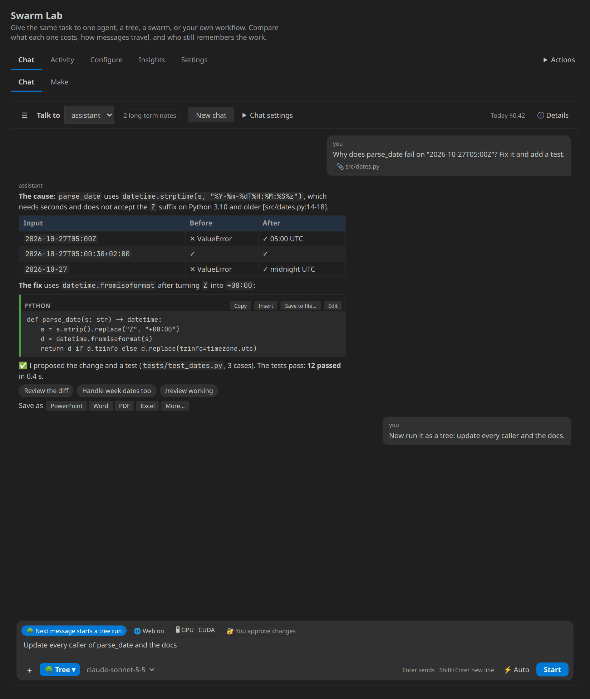

- [GitHub project](https://github.com/joeaelkhoury/SwarmLab)
- [Releases and VSIX downloads](https://github.com/joeaelkhoury/SwarmLab/releases)
- [Report a problem](https://github.com/joeaelkhoury/SwarmLab/issues)

**Created by Joe El Khoury.** Swarm Lab is released under the source-available [Swarm Lab License](https://github.com/joeaelkhoury/SwarmLab/blob/main/LICENSE): you may
install, use and study it free of charge; copying, redistributing or republishing it, or a modified version, requires
the author's written permission. The extension ships as a built package: this repository carries the documentation,
screenshots and the Python client, not the extension's source code. Install it from Open VSX (publisher **joe-el-khoury**)
or from a VSIX attached to a GitHub Release, and compare
its SHA-256 with the `.sha256` file published beside it. See [NOTICE](https://github.com/joeaelkhoury/SwarmLab/blob/main/NOTICE.md) and
[how to cite](https://github.com/joeaelkhoury/SwarmLab/blob/main/CITATION.cff).

## 1. What Swarm Lab is

Swarm Lab is an AI coding assistant and a lab for teams of AI agents, inside VS Code. You stay in charge: every step is
visible, every edit and command is yours to approve, and nothing runs on a server you did not set up.

- **Chat with your code.** Ask questions, describe changes, attach files; the chat reads your code, your files and the
  conversation. Pick the mode next to Send: Chat, one agent, a Tree, a Swarm, or your own Graph of steps.
- **See and fix what you attach.** Tap any attached file to see it, edit a text file in place, or **Fix and resend**.
- **Many model servers, side by side.** Ollama on your machine, a company gateway, vLLM on a GPU box, OpenRouter, your
  own API URLs — each a **connection** with its own address, settings and API key (kept in VS Code's secret storage,
  never in your settings). Name a model on any of them as `@id/model`.
- **One place for every model.** *Setup → Models* lists every connection's models; you pick who does what — lead,
  worker, chat, decisions, embeddings, the Atlas's entity pass — from that list, with no names to type. Automatic
  model choice and fallbacks live there too. Setup presets set it all up in one click.
- **The Atlas.** A map of the entities in your code and documents: your own types, colours and names (paste a list or a
  CSV), with your own questions about any entity.
- **Try models before you trust them.** Try a reranker on your own texts, see the request and copy it as curl, Python
  or JavaScript. Run a **campaign** of many questions over several models, with hit@1, MRR, nDCG and speed, and a
  report. **Chain any models one after another** — embeddings → reranker → generate — and compare whole pipelines.
- **Run work safely.** Commands run in a sandbox (a venv, Docker, or an environment you choose); you see where.
- **Your language.** The panel, settings and answers are available in French (technical terms stay in English).

The extension you install is a single, self-contained build; you need no account, no configuration files and no
server to begin. Just install it and open **Swarm Lab: Open**.

## 2. Install and open

You need:

- VS Code 1.95 or later, or an editor compatible with that extension API.
- A small, preferably non-sensitive project folder for learning.
- A model connection for real AI answers, or the offline mock for an interface demo.
- Your project's test tools if you want to run its tests.

Download the VSIX from [Releases](https://github.com/joeaelkhoury/SwarmLab/releases).
In VS Code, open **Extensions → ⋯ → Install from VSIX…** and select the download.
The publisher ID is **joe-el-khoury**; it is different from the GitHub account name.

Alternatively, with VS Code's command-line launcher:

```sh
code --install-extension swarm-lab-<version>.vsix
```

(Use the name of the file you downloaded, for example `swarm-lab-0_59_1.vsix`.)

Then:

1. Choose **File → Open Folder…** and open your practice project.
2. Open the Command Palette with **Ctrl+Shift+P** (macOS: **Cmd+Shift+P**).
3. Run **Swarm Lab: Open**.
4. If updating an existing installation, use **Developer: Reload Window** if needed.

The first time, the panel asks how it should look (you can change it any time in **Actions → View**):

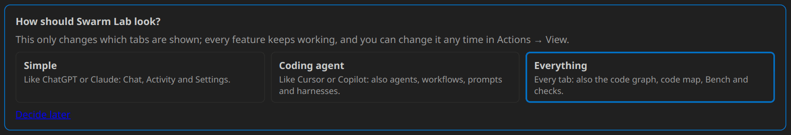

| View | Shows | Like |
|---|---|---|
| **Simple** | Chat · Activity · Settings | ChatGPT or Claude |
| **Coding agent** | also Configure (agents, workflows, prompts, harnesses, project) | Cursor or Copilot |
| **Everything** | also Insights (code graph, code map, Bench, checks) | |

A view only hides tabs: every command, setting and agent works the same in every view.

No TypeScript source checkout or npm build is needed to use the installed extension.

## 3. Connect a model—or try the mock

Open **Settings → Setup**, choose a provider, save settings, then run **Test connection** and
**Test tool calling**.

| Choice | What you need |
|---|---|
| Anthropic API | Your Anthropic key and exact model IDs |
| OpenRouter | Your OpenRouter key, credits, and model IDs |
| OpenAI-compatible API | The service's API base URL, models, and any required key |
| Ollama / LM Studio | A running local API server with a model loaded |
| VS Code language models | Access through VS Code; a subscription may be required |
| Offline mock | No key; scripted demonstration responses, not real reasoning |

Use **Set API key** for provider credentials; extension keys use VS Code Secret
Storage. Never paste keys into tasks, rules, screenshots, or shared configuration.
Set the **Lead model** and **Worker model** to models offered by your provider.
Using the same model for both is fine initially.

Local model software and models are not installed by Swarm Lab. Start that service
first. Hosted providers may charge separately. If native tool calling fails, try
**Tool calling → Text**, or choose a model that supports tools.

### Behind a company proxy: certificates

If calls fail with *unable to get local issuer certificate*, *self-signed certificate in certificate chain* or another
certificate error, your network re-signs HTTPS traffic with its own authority. Open **Settings → Setup → Certificates
(trust store)**:

| Setting | Use it when |
|---|---|
| **CA files to trust** | You have your company's root CA file (PEM, or DER `.cer`); ask IT, or export it from your browser |
| **Also trust the system's certificates** | Your company installs its certificate in Windows, macOS or Linux (usual on managed computers) |
| **Same trust for commands and the local server** (on) | `pip install`, `npm install`, `git` and `curl` run by agents must work too |
| **⚠ Do not check certificates** | Last resort only: anyone on the network can then read the traffic, keys included |

Certificates are added to Node's own authorities and apply at once. **Check certificates** says what is trusted and
tries one HTTPS request to your provider.

### When an answer is wrong: 🩺 Check

**🧭 Based on…** under every answer says what it was based on (“Based on 3 files and 1 web page”, or “the model’s own
knowledge: no file was read”); tap it to open, right there, the sources and the four steps that led to it, and tap again, ✕ or
Esc to close it. `/check` in the chat, or **Is this answer wrong?** inside that trace: follow the words the right answer needs through
every stage (read from the file, the search index, search, the Atlas, what the model got) and see where they were
lost; the settings really in effect and misspelled ones; and a reading and search check with known files (“00123”
must stay “00123”), run again on its own after updates.

### The Atlas of your documents (optional)

Turn it on in **Setup → Atlas** and run **Swarm Lab: Build Atlas**: your contracts, meetings, e-mails and reports become
pages for each client, person, project and contract, with facts and their sources, links, a timeline and a warning
where documents disagree. Agents use it on their own; in the chat, `/atlas` and `/atlas ACME` show it as cards with a graph, and answers get
chips that open those cards; browse it at
**http://127.0.0.1:8787/atlas** (graph, tables, timeline); export it as an Obsidian vault. In ⚙ Manage, add your own types with their colours, the exact names and codes
you want found, and corrections that stay.

### Reminders and your day

`/remind tomorrow 9:00 call Sara` (or `in 20 min …`, `every weekday 8:30 …`, `demain 9h …`): VS Code tells you when it is
due, and the 🔔 in the status bar counts today's. With the local server running, **Swarm Lab: Open Today** opens
**http://127.0.0.1:8787/today**: your reminders and the agents' tasks for the day, on your computer or your phone.

### Pictures in attached files

Attached pictures, and the pictures inside attached Word, PowerPoint, Excel files and PDFs (scanned pages, photos,
charts), go to the model when it can see them: known from its name, from **Setup → Model provider → Models that see
pictures**, and from the provider's answers. Models that cannot see get a short note instead.

### Language

The panel is in **French** when VS Code is in French (or choose it in **Settings → Setup → Language**); technical terms
(agent, prompt, token, harness, tree, swarm, graph…) stay in English, and agents answer in French. Settings and
commands follow VS Code's display language.

## 4. The message box

Type in the box at the bottom of **Chat**. **Enter** sends; **Shift+Enter** adds a line.

### Choose how the next message is handled

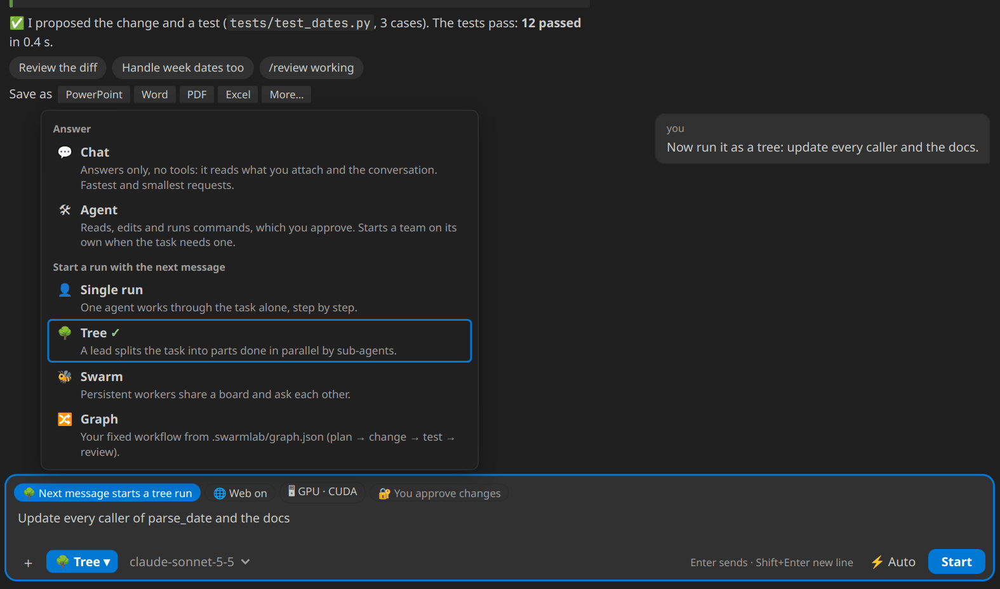

| Mode | Use it when you want to… | What happens |
|---|---|---|
| 💬 **Chat** | ask, explain, draft, compare: anything that needs no file changes | Answers only, no tools; it reads what you attach and the conversation. Fastest. |
| 🛠 **Agent** (default) | work on your code: fix, add, refactor, test | Reads, edits (as diffs you approve) and runs commands you approve. Starts a team itself when the task needs one. |
| 👤 **Single run** | get one bounded result with a report (steps, tokens, cost) | One agent works the task through, followed in Activity → Runs. |
| 🌳 **Tree** | split work into independent parts (one per module, per file, per question) | A lead hands parts to sub-agents that work in parallel. |
| 🐝 **Swarm** | work where findings must be shared (an audit, a migration) | Persistent workers share a board and ask each other. |
| 🔀 **Graph** | repeat a fixed process (plan → change → test → review) | Your workflow from `.swarmlab/graph.json`. |

In a run mode the button says **Start**, and *Next message starts a tree run* shows above the text; your message is sent as
`/tree <your text>`. A message that starts with a command (`/review working`) is sent as typed.

**Run Map:** a run started from the chat is drawn live in the conversation: a tree of agents, a swarm around its board,
or your workflow's steps, with time, tokens, cost and files ticking, and **▶ Replay** when it ends. **🎯 Auto run** in the
chat bar (Agent mode) lets a model pick the mode for each task, your worker model if you have no decision model.

### Attach and make things: ＋

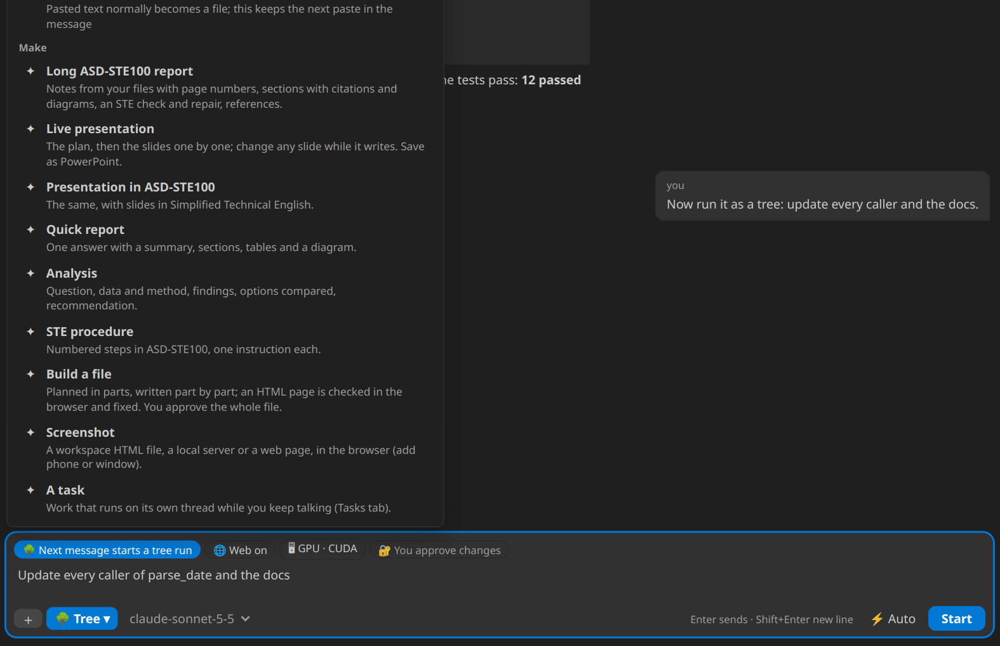

Upload a file or picture, pick a workspace file (or type **@**), screenshot a page, keep the next paste as text, start
any document of the Make tab (report, slides, analysis, STE…), or open the Lab or Access.

**Pasted text becomes a file**: two lines or more (or a long line) is attached as `.swarmlab/uploads/pasted-….csv`,
`.json`, `.py`, `.log`… with its type and size on the chip; **⤶** puts it back as text, **Ctrl+Shift+V** pastes as text.

### Every command: type /

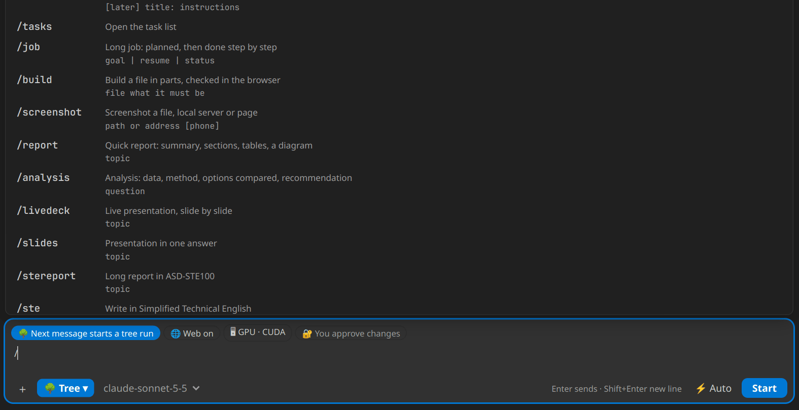

↑ ↓ choose, Enter or Tab fills it in, Escape closes. Commands without arguments (`/new`, `/gpu`, `/tasks`) are sent at once.

### What the status chips say

*🌐 Web on/off*, *🖥 the device runs use* and *🔐 You approve changes* (or *⚡ Works on its own*) are always visible above
the text; click one to change it. While the assistant works, **Send** becomes **■ Stop**; type and it becomes *Send
later*.

### Try it

```text
Explain what this project does. Read the relevant files first, name the files
you used, and do not change anything.
```

```text
Find one missing edge-case test. Propose the test and explain why it matters.
Ask before running commands. Do not change unrelated files.
```

- Review **Waiting for you** before approving an edit or command: **Apply** accepts it, **Reject** declines it.
- **Stop** interrupts work, but does not undo already applied changes or command effects.
- A good task states the goal, relevant files, constraints, and a test for success.

## 5. Conversations, details and access

**☰** opens your conversations as a sidebar (search, open, export, *＋ New chat*):

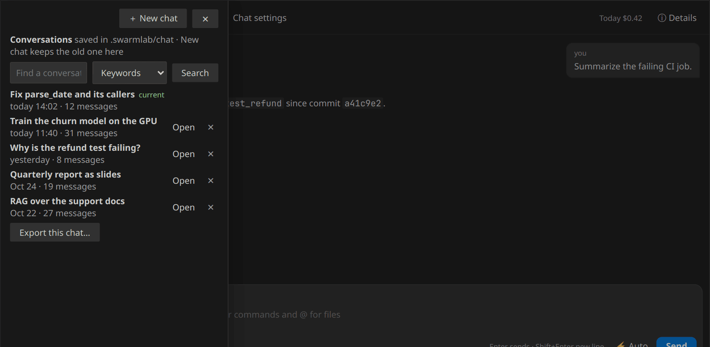

**ⓘ Details** holds everything about this chat in one panel: Context, Sending, Memory, Steps, Data, **Access** and Costs
(today's cost shows beside the button). **Access** shows what the assistant may do, and changes it:

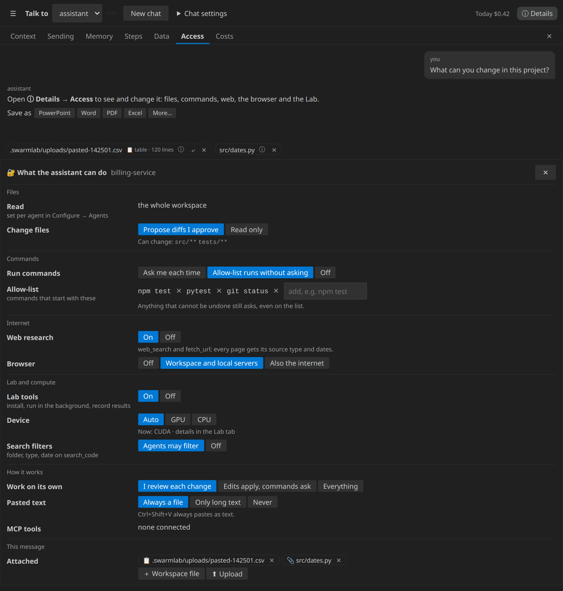

| Row | Choose… | When |
|---|---|---|
| Change files | *Propose diffs I approve* · *Read only* | Read only for questions, reviews, unfamiliar repositories |
| Run commands | *Ask me each time* · *Allow-list runs without asking* · *Off* | Allow-list for commands you run all day (tests, linters); anything irreversible still asks |
| Web research · Browser | On/off · off, local servers, also the internet | The internet only when the task needs current pages |
| Lab tools · Device | On/off · Auto, GPU, CPU | CPU to keep the GPU free, or to compare |
| Search filters | *Agents may filter* · *Off* | Off only if filtered searches miss answers in your project |
| Work on its own | *I review each change* · *Edits apply, commands ask* · *Everything* | Everything only on a branch or a copy you can throw away |
| Pasted text | *Always a file* · *Only long text* · *Never* | |

**Labels and names** (☰): each conversation can have labels and a name of your own. **＋ Label** offers labels to tap
(yours, its topics, common kinds of work: no model call) and completes as you type; ✎ renames it. Click a label in the
bar to filter, or type `#bug timeout` in the search box to search only conversations labelled Bug.

**Edit a sent message** (✎ on it): a full-size editor with the conversation before it, its files and pictures (remove,
upload, pick, paste or drop more); **Resend** (Ctrl+Enter) replaces the messages after it.

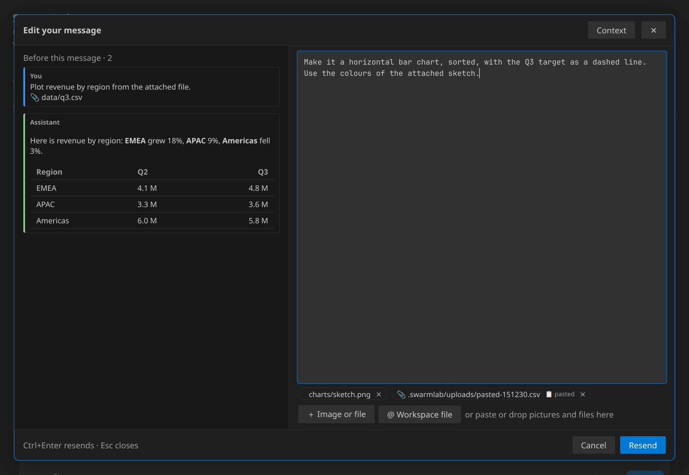

## 5b. Review a change by its conditions and your own inputs

A convincing explanation is not a check. In a study with 86 Python programmers, explanations did not improve their
judgement of AI-written checks, and explanations that left out conditions made them more confident without making them
more accurate. So every edit card shows **when the change applies, when it does not, and the inputs it was checked
with**, and lets you run the proposed code yourself.

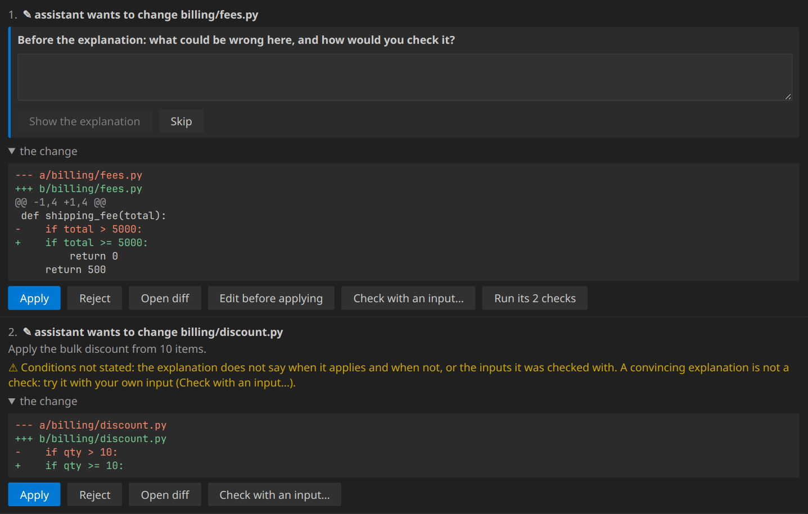

| On the card | What it does | When to use it |
|---|---|---|
| **Applies when / Does not apply when / Checked with** | The agent states the condition with its boundary and the inputs it tried (`shipping_fee(5000) → 0`) | Read the boundary first: `>` and `>=` differ exactly there |
| **⚠ Conditions not stated** | A change to logic that says none of this | Do not approve on the explanation alone: check it |
| **Check with an input…** | Runs the **proposed** version and the current one (Python, JavaScript, TypeScript) with your input and compares with what you expect: `✓ shipping_fee(5000): with the change returns 0, as expected (now: 500)` | Any change to a condition, a calculation or a limit: choose the input at the boundary |
| **Run its N checks** | Runs the agent's own inputs | A quick first look; they are the agent's choice, so add one of yours |
| **Think first** (*Settings → Setup → Review*: off · risky changes · always) | The explanation stays hidden until you write in a line what could be wrong and how you would check it | Where a mistake costs most (money, access, limits, dates); it takes longer |

Your checks and your note go to the agent with your answer, so a failed check is fixed first. The first check of a
window asks before running code (the file's top-level code runs, as when it is imported); nothing in your project
changes.

**Practice:** `/practice [folder]` finds, read-only, one change made with an AI in this project's git history that was
later fixed as a bug, shows the code before the fix, and shows the real fix only after you have written where the
problem is and how you would check it. **Swarm Lab: Reviewer check** now asks the same before revealing the planted
mistake, and **My AI reliance report** counts edits checked with an input, notes written first, and whether your reviews
get slower week after week.

The studies behind it: reviewing e-mail drafts (Fu et al., 2026, arXiv:2609.01976: writing your own explanation first
found 78% of errors instead of 68%, about 25 s more per draft; not measured on code), judging AI-written assertions
(Kaufman et al., 2026, arXiv:2607.08885), and pull requests taking about 1.5 times longer to merge in companies using AI
agents (Chen and Stratton, 2026, not yet peer-reviewed, data from Jellyfish).

## 5c. Understand a change without stopping the agent (optional)

Turn on **Setup → Understanding mode** (off by default). Then, before a task, **＋ → Brief**: your approach in one line,
a few inputs with the result you expect (`save_task('   ')` → `False`), and what is still unknown. The agent keeps
working at full speed; your inputs run on each proposed change on your computer, and you hear only about one that fails,
with **Send to the agent**. When it is done, **Explain this change** on the Files changed card shows the change as a path
through the code, each step with its line, checked on the files, and one question to check your own understanding.

| Setting | Cost |
|---|---|
| **Checks only**: brief, your inputs run in the background, a card only when one fails | 0 tokens (about 40–60 words added to a message with a brief) |
| **Checks + explain on demand**: also *Explain this change* | One call to the worker model when you press it, with the diff only; cached |
| **Data guards**: a target built from columns that are also features (label leakage) | 0 tokens |
| **Count unchecked changes**: a ◐ chip, never blocking | 0 tokens |

## 5d. Security scan: /scan

`/scan` scans the whole project, `/scan changed` your uncommitted changes, `/scan src/server` a folder or a file. A 🛡
card shows the plan first (files, models, estimated cost); nothing runs before **Start**.

- **Several cheap models, two runs each.** No model finds everything, and one run finds only part of what two runs
  find, so by default the two cheapest models of your list, from different vendors, each scan twice; the results are
  merged.
- **A verifier that can only confirm or reject.** Each model re-reads its own findings; what it withdraws still goes to
  a model from another vendor, which confirms or rejects every finding and cannot add new ones.
- **Your project's facts** go in `.swarmlab/security-rules.md`, one per line (*auth is always done by `requireUser`*).
  When you dismiss a finding with a reason, the card offers to add it there. Whole config files and docs are never sent:
  they made strong models find less.
- **🧪 Reproduce** writes a small test for one finding; you read it and approve it; it runs in the chat's isolation
  environment, never on **machine**. Confirmed means it ran and showed the problem.
- Severity is the model's **estimate**. Every call counts in your spend; a scan stops at `swarmLab.security.maxCostUsd`.
  Settings: Setup → Safety and limits → **Security scan**.

**Your existing rules work as they are.** Swarm Lab reads `.swarmlab/rules.md`, then `AGENTS.md`, `CLAUDE.md`,
`.cursorrules` and `.github/copilot-instructions.md` if they exist. When you reject a change, say why: one click saves the
reason as a project rule. **Alt+Enter** approves the first waiting request, **Alt+Backspace** rejects it; **Ctrl+Alt+W O**
opens Swarm Lab from anywhere. New here? **Help → Welcome → Get started with Swarm Lab** walks you through the first run.

## 6. Find your way around

| Group | Tabs | Purpose |
|---|---|---|
| **Chat** | Chat · Make | Talk with the assistant; make documents |
| **Activity** | Tasks · Runs · Lab | Everything running or finished; the badge counts what runs now |
| **Configure** | Agents · Workflow · Prompts · Harness · Project | Specialist agents and their permissions, graph workflows, instructions, harnesses, project rules and plans |
| **Insights** | Codebase Graph · Code map · Bench · Check | Your code's structure; compare setups on repeatable tasks; check the configuration |
| **Settings** | Setup · Tools · Server | Providers, models, limits and options; MCP tools and skills; the Swarm Lab server |

Code maps rely on your project's VS Code language support. Search indexing, decision models, automatic model routing,
MCP, Bench, the Lab and Refine are optional—not setup prerequisites.

**Public benchmark.** **Bench → Public benchmark…** makes a small Python project with known bugs and the same five tasks
for Single, Tree and Swarm, checked by tests (some hidden from the agents). **Bench → Public report** turns a result into
Markdown to publish: models, versions, every run, cost, and how to rerun it. See [docs/BENCHMARKS.md](https://github.com/joeaelkhoury/SwarmLab/blob/main/docs/BENCHMARKS.md).

## 7. The Lab: GPU or CPU, apps, training and results

**Activity → Lab** (or `/lab` in the chat). It finds the GPU (NVIDIA with its CUDA version, AMD, Apple Silicon), Python and
PyTorch, and every command an agent runs gets `SWARMLAB_DEVICE` (cuda, mps or cpu). Apps, servers and training runs go
in the background with their logs, address and screenshots; finished experiments go on the results board, where
metrics become charts.

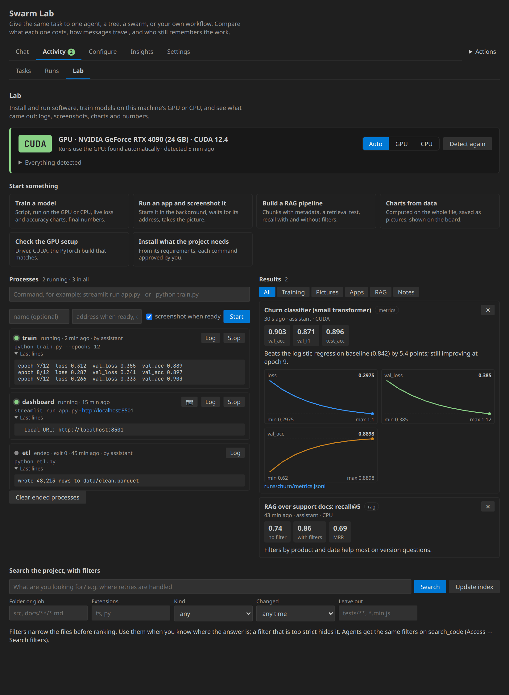

Ask in plain words ("train a small model on data.csv and show the curves", "run the app and screenshot it") or use a
*Start something* card. Installs and background commands are approved like any command. **Search the project, with
filters** tries the same folder, type and date filters agents get on `search_code`: useful when you know where the
answer is, harmful when a filter is too strict (agents are told to search again without it).

## 8. Refine a harness on your task

A *harness* (**Configure → Harness**) is a saved way to run: the mode, settings, permissions, and **instructions for every
agent** (instructions, guardrails, tool guidance, skills to load first). **Refine this harness** improves it on one of
your tasks, adapted from the Propose–Probe–Compose step of Harness² (Xu et al., 2026, arXiv:2610.14224):

1. the task runs with the harness as it is;
2. the lead model proposes *general* edits (planning, checking, tool use) and *domain* edits (this kind of task), each
   aimed at something the run showed;
3. each edit runs on the same task;
4. the edits that helped are combined, and that harness runs too.

Refine is **optional and never runs by itself**: it starts only when you press *Refine…* and approve the number of runs,
probe runs are read-only by default, edits never change what agents may access, the provider or the model, and
nothing is saved until you choose to.

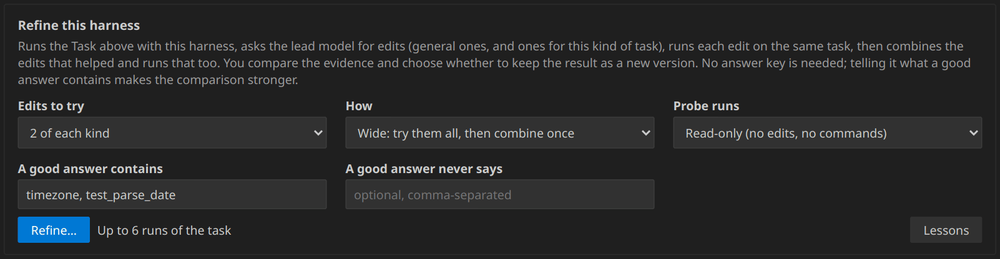

### When to use each option

| Option | Choose | When |
|---|---|---|
| **Edits to try** | **1 of each kind** (Wide: 4 runs) | A first try, or a task that is slow or expensive to run |
| | **2 of each kind** (Wide: 6 runs) — default | The usual balance between finding a good edit and cost |
| | **3 of each kind** (Wide: 8 runs) | A quick, cheap task where you want more ideas tried |
| **How** | **Wide: try them all, then combine once** (2 + 2k runs) | You don't know what is wrong yet: several independent ideas tried side by side |
| | **Deep: rounds, each building on the last** (1 + 3k runs) | Fixing one problem reveals the next (first stop the loops, then make it test); a round is kept only if its run was at least as good |
| **Probe runs** | **Read-only (no edits, no commands)** — default | Questions, reviews, analyses, plans: anything where reading is enough to show the difference. Safe, no approvals during the runs |
| | **As the harness allows** | The difference only shows when files change or tests run (bug fixes with tests). Each edit and command still asks you; work on a Git branch or commit first |
| **A good answer contains** | words, comma-separated | You know what a right answer must mention: a function or test name, a number, a file |
| **A good answer never says** | words, comma-separated | You know wrong answers: "I could not", an old API name, a forbidden step |

Without these words Refine still compares the runs (finished or not, the run's own check and tests, errors, loops,
tokens); with them the comparison is stronger.

**Use Refine** for a harness you run often (a bug-fix routine, a report generator, a review), when its runs loop, skip
tests, miss parts of the answer or cost too much. **Skip it** for one-off tasks: running the task 4 to 8 times costs
more than the task itself.

### Reading the result

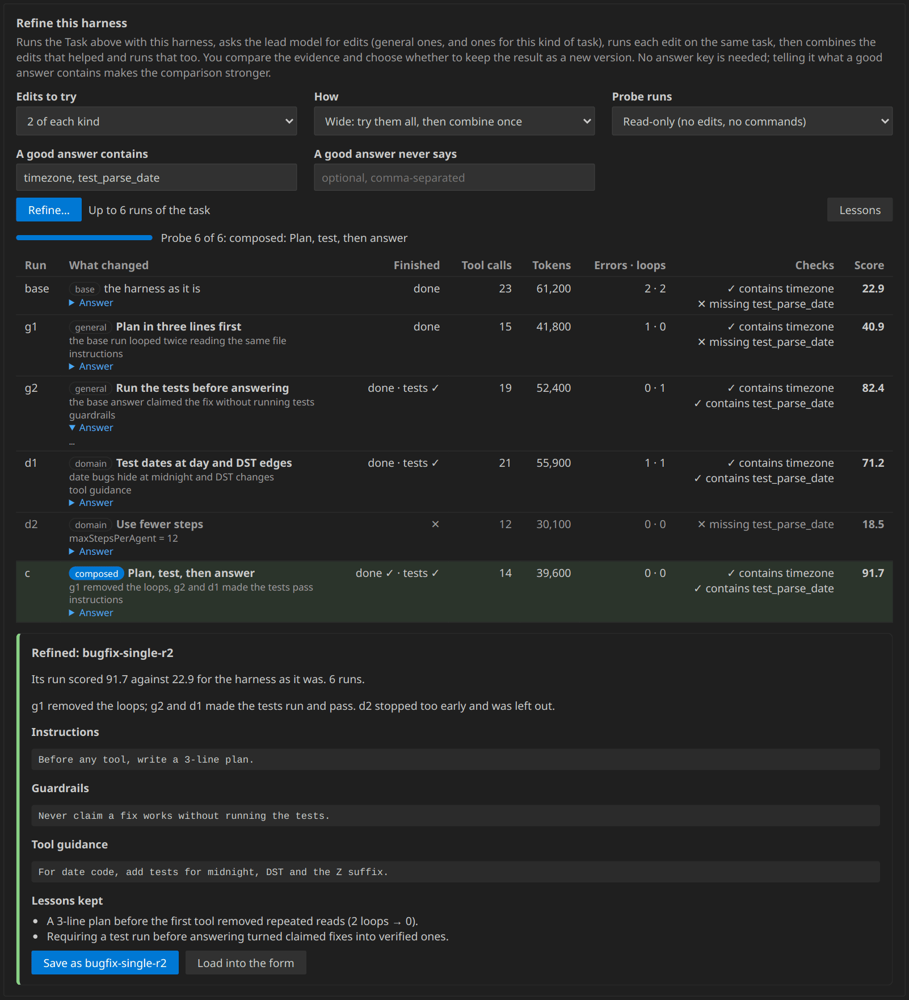

Each run is a row: what changed, whether it finished (✓ checked, tests ✓/✕), tool calls, tokens, errors · loops, the
checks, and a score that orders the table (checks first, then finishing, then fewer errors, loops and tokens). Open
*Answer* to read a run. The best run is marked green.

- **Refined: name-r2** — its run beat the harness as it was: **Save as name-r2** keeps it as a new version (the original
  stays), or **Load into the form** to edit it first.
- **Composed, but not better** — keeping the current harness is safer; you can still look at it.
- **Lessons** the evidence supported are kept in `.swarmlab/harness-lessons.md` (edit freely) and read by the next
  refinement. Server jobs that use the harness get the same instructions.

## 9. Save answers as PowerPoint, Word, PDF, Excel…

Under every answer: **Save as PowerPoint · Word · PDF · Excel · More…** (HTML, Markdown, text, notebook, JSON, CSV).
Choose a template, edit the text and see the slides before saving; slides stay fully editable in PowerPoint.
`/report`, `/slides` and `/analysis <topic>` ask for a complete document; `/ste` writes in ASD-STE100 Simplified
Technical English and `/stecheck` checks it. [Documents guide](https://github.com/joeaelkhoury/SwarmLab/blob/main/docs/DOCUMENTS.md).

## 10. Try a bounded run

A chat is a conversation. A run has a task, an organization of agents, limits, and a result/usage report.

1. Save your files and preserve existing work, ideally with a Git commit.
2. Choose **👤 Single run** next to Send (or open **Activity → Runs**), write a small task, and press **Start**.
3. Review safety settings and token/step limits.
4. Follow the steps and answer approvals.
5. Review the diff and tests before keeping or merging the result.

| Mode | Organization | Try it for |
|---|---|---|
| Single | One agent | A focused fix or explanation |
| Tree | Lead with temporary sub-agents | Independent investigations |
| Swarm | Lead with persistent workers and a shared board | Work requiring shared findings |
| Graph | Your configured workflow controls transitions | Repeatable plan, fix, test, review |

More agents do not automatically mean better answers or lower cost. Start small. Graph needs a configured workflow.
The Agent mode can start a run itself, and its choice is not guaranteed optimal. [Read the mode-selection guide](https://github.com/joeaelkhoury/SwarmLab/blob/main/docs/RUN-MODES.md).

## 11. Tasks, long jobs, documents and answers you can check

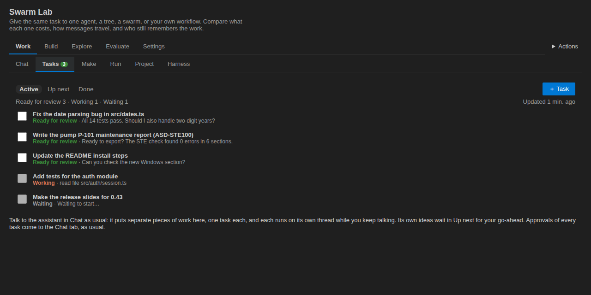

- **Tasks.** Keep talking in Chat: the assistant puts separate pieces of work on **Activity → Tasks**, one task each,
  and each runs on its own thread while the conversation continues. *Ready for review* shows each task's last
  question; tasks the assistant suggests wait in **Up next** for your approval. Open a task to follow it live,
  answer it, or mark it done. You can also type `/task <title>`.
- **A working card** in the chat while the assistant works: the current step, each completed step, live tokens and
  cost, and a clear signal when an approval is waiting.

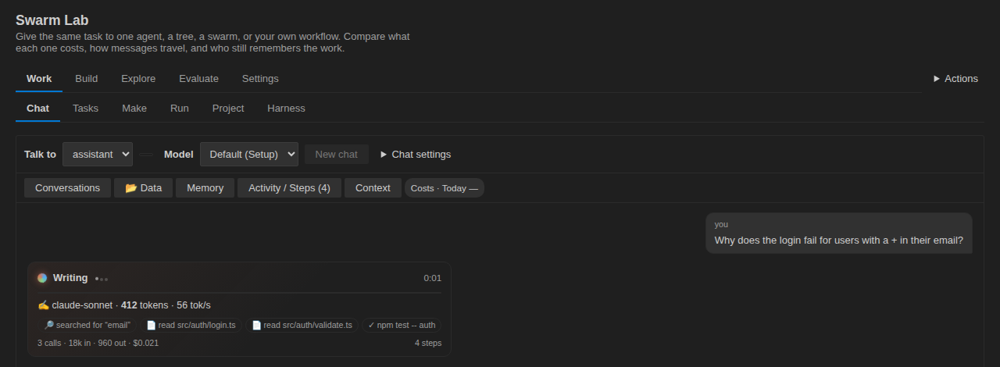

- **Long ASD-STE100 reports** from your files: `/stereport <topic>`. Notes with page numbers, sections with
  citations and diagrams, an STE check and repair of each section, references from the files' own metadata.
- **Live presentations**: `/livedeck <topic>`. The plan first, then the slides one by one; any slide can be edited
  while the deck is written. Save as PowerPoint with speaker notes.
- **Long jobs: `/job <goal>`**: a whole notebook rewritten cell by cell, or a repository changed file by file, beyond
  the model's limits: the lead model plans and reviews, the worker model does each step with the plan and a journal
  of the steps done; each step is checked and retried, the state is saved after every step (`/job resume`).
  Provider rate limits and outages are waited through; the job pauses and resumes instead of failing. Each cell
  knows everything defined before it; repository jobs first build a map of the code base; the plan is checked and shown first; the code can be run to check it; every
  step is visible live in Activity → Runs, with its diff.

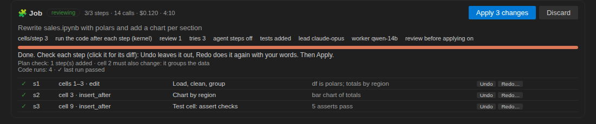

- **`/build <file> <what>`**: a complete file planned and written part by part; an HTML page is checked in the
  browser (screenshot and console errors) and corrected before you approve it.
- **Browser and screenshots**: agents can capture your HTML files, local servers and web pages, and read pages after
  their JavaScript has run, with your own Chrome, Edge or Chromium; `/screenshot site/index.html phone`.
- **Cited answers** (optional): step-by-step answers in which each statement links to the exact file lines, page or
  web page, and each citation is verified: ✓ read, ⚠ to check, ✕ not found.
- **Work on its own** (⚡ Auto, optional): no review until the work is complete; irreversible actions still ask.
- **Context windows per model** (optional, for self-hosted models through LiteLLM, vLLM, Ollama…): each call is
  fitted to its model's window, from the server or your list, and cut answers continue in parts. When disabled,
  requests are sent unchanged.
- **Helpers for smaller models** (Mistral, Gemma, Llama, Qwen…), optional: repaired tool calls, tolerant edits, no
  repeated calls, a quick check after edits.
- **Live tokens** while the model writes, and an explanation instead of “No answer” when a model returns nothing.

## 12. Chat commands and options

### Chat commands

| Command | What it does |
|---|---|
| `/single <task>`, `/tree <task>`, `/swarm <task>`, `/graph <task>` | Start a run (or choose the mode next to Send); follow it in **Activity → Runs** |
| `/remote single\|tree\|swarm\|graph [--no-repo] [--repo NAME] [--files\|--no-files] [--workflow NAME] [--agent NAME] <task>` | Run it on the Swarm Lab server; the answer and its files return to the chat |
| `/ask <agent> <question>` | Ask an agent of the last run |
| `/review [working\|<branch>]` | Review your changes: the working tree or a branch |
| `/scan [changed\|<path>]` | Security scan: several cheap models, a verifier from another vendor, your rules (section 5d) |
| `/task <title>[: instructions]` | Start a task on its own thread (**Activity → Tasks**) |
| `/task later <title>` | Put a task in **Up next**, waiting for your approval |
| `/tasks` | Open **Activity → Tasks** |
| `/report <topic>`, `/slides <topic>`, `/analysis <topic>` | A short document in one answer |
| `/ste [procedure\|description\|rewrite\|report] <topic or text>` | Write in ASD-STE100 Simplified Technical English |
| `/stecheck` | Check the last answer against ASD-STE100 |
| `/stereport [sections] <topic>` | A long ASD-STE100 report from your attached files, with citations, diagrams and references |
| `/livedeck [ste] [slides] <topic>` | A presentation you can edit while it is written; Save as PowerPoint |
| `/job <goal>` | A long job: a notebook cell by cell, or files one by one, with a plan, a journal and a review |
| `/job resume`, `/job status` | Continue the last unfinished job; list the jobs |
| `/build <file> <what>` | A file planned and written part by part; an HTML page is checked in the browser |
| `/screenshot <path or address> [phone] [window]` | A screenshot of a workspace file, a local server or a web page |
| `/lab`, `/gpu` | The device runs use, processes and the latest results; `/lab start <command>`, `/lab logs <name>`, `/lab stop <name>`, `/lab detect` |
| `/practice [folder or file]` | Review practice from this project's git history (read-only; the fix is shown after your answer) |
| `/remember <fact>` | Save a fact to memory |
| `/new` | Start a new chat |
| `/help` | List the commands |
| `@` | Attach a file, or send the message to one of your agents |

### Options

These options are in **ⓘ Details → Context** and in **Settings → Setup**. The ⚡ **Auto** button next to Send switches
*Work on its own*.

| Option | Choices | Default |
|---|---|---|
| Work on its own (⚡ Auto) | Off · Edits (edits apply, commands ask) · Everything (no review; continues up to 3 times at the step limit). Irreversible actions always ask. | Off |
| Answer length | Short (about 150 words) · Normal (complete, without padding) · Detailed (step by step, with reasons and examples) | Normal |
| Cited answers | Off · Code (file and lines) · Everything (also pages, slides and web pages) | Off |
| Show tokens live | On · Off | On |
| Context windows per model | Off · Ask the server and use my list first · Only my list (`model=window[/max answer]`) | Off |
| Continue a cut answer when | The server reports a cut · All output tokens were used · The text also looks unfinished | The server reports a cut |
| Helpers for smaller models | Off · Recommended (models in your list) · All models; each helper can be switched on or off | Off |
| File details sent to the model | What a citation needs · All details · None | What a citation needs |
| Record answer outcomes | On · Off (numbers only, no message text) | On |
| Browser | Agents can use the browser · Internet pages too · Browser path | On · On · detected automatically |
| /job (context) | Context per step (lean · balanced · full) · Files the job may read · Understand the code first (auto · always · never) | Balanced · whole workspace · Auto |
| /job (plan and checks) | Show the plan before starting · Check the plan · Run the code (off · after each step · at the end) · Live Jupyter kernel · Notebook: cells per step (1–10) · Add test steps · Check command · Review before applying | On · On · Off · On · 3 · Off · none · On |
| /job | Steps at once (1–4, different files only) · Review rounds (0–3) · Tries per step (1–5) · Steps at most · Lines per part · Agent steps (turns, tokens, time) · Wait for a busy provider up to | 1 · 1 · 3 · 60 · 180 · Off (6, 80,000, 240 s) · 10 min |
| /build | Parts (2–16) · Browser checks for HTML (0–3) | 8 · 1 |
| /stereport | Sections (3–12) · Repair passes (0–2) · Web pages as sources · Pages to read (0–6) · Author | 6 · 1 · On · 3 · none |
| /livedeck | Slides (4–25) | 10 |
| Tasks | The assistant can create tasks · Tasks working at once (1–4) | On · 1 |

See the [changelog](https://github.com/joeaelkhoury/SwarmLab/blob/main/CHANGELOG.md) and the [manual](https://github.com/joeaelkhoury/SwarmLab/blob/main/MANUAL.md) (sections 40 to 58).

## 13. Safety before speed

- **Checkpoints:** before each chat message, Swarm Lab saves your folder in a shadow Git repository kept outside it.
  **⟲ Rewind** on a message puts the files back as they were before it (and, if you choose, the conversation too);
  **↩ Undo rewind** brings them back. Your own repository, branches and index are never touched; ignored files and
  dependencies are not saved. Off with `swarmLab.checkpoints.enabled`.
- **A worktree per agent (optional, `swarmLab.worktrees.perAgent`):** in Tree and Swarm runs each worker edits its own
  Git worktree, so parallel agents cannot overwrite each other. At the end, each changed file comes to you as one review
  card, merged three ways with your folder; two agents on the same lines give conflict markers to fix.
- **Cost forecast:** before Tree, Swarm and workflow runs (`swarmLab.runs.costForecast`: or every run, or never), a
  likely cost and an upper bound in tokens and dollars; a run stops at `swarmLab.runs.maxCostUsd` ($5), or earlier at
  `swarmLab.costBudgetUsd` or today's limit. Every step resends
  the conversation, so more agents and steps cost much more.
- Swarm Lab's native interactive edits are proposed as diffs; commands ask by default.
- Allow-listed commands can run without another click. A test script can execute arbitrary code.
- Destructive commands still require confirmation, including when allow-listed.
- Worktrees and run branches help review changes; they are **not an operating-system sandbox**.
- Git safety needs Git and a repository with a commit. Inspect Keep/Revert choices carefully.
- MCP, external engines, and unattended Bench have different permission paths; read the manual first.
- Scoped reads support bounded native single/chat read-only use, not general multi-agent isolation.
- Saved requirement status or a successful command is not proof of correctness or fresh test evidence.
- Model providers receive selected context; remote tools and services may receive additional data.
- Review code, run meaningful tests, and check provider costs before merging.

## 14. Python and background jobs (optional)

Python users can use the native server launched from the **installed extension's
**Settings → Server** tab**; no extension source checkout is required. Docker is optional.
A reachable server still needs a configured provider, permissions, and repositories.
VS Code language models cannot serve as a standalone server provider.

Download the separate Python starter files together; installing the VSIX does not
install them. Start with offline payload previews, then submit a small job to your
configured server. A mock can demonstrate the interface, not prove a real fix.

[Python workflows](https://github.com/joeaelkhoury/SwarmLab/blob/main/docs/PYTHON-WORKFLOWS.md) covers downloads, server setup,
credentials, real command-line options, approval exits, and report handling.
The [complete four-mode repair demo](https://github.com/joeaelkhoury/SwarmLab/blob/main/docs/PYTHON-WORKFLOWS.md#7-complete-four-mode-repair-demo)
includes a tiny broken fixture, baseline Git setup, exact preview/submission commands,
and independent single/tree/swarm/graph runs. Offline checks are not live-model verification.

### New in 0.39.0: environments and the Python library

- **Environments.** A job can prepare its own environment before its agents start (`"environment": "auto"`):
  dependencies installed, a Python virtual environment, a container of any image, a virtual screen for VS Code
  extension or browser tests. Every command of the job then runs inside it. Try one without agents:
  `swarm-lab env . --test`. [Environments guide](https://github.com/joeaelkhoury/SwarmLab/blob/main/docs/ENVIRONMENTS.md).
- **Python library.** `pip install ./clients/python`, then `from swarmlab import SwarmLab, Agent, Workflow, Environment`:
  every job option as a keyword, workflows built and checked in Python and saved on the server, approvals answered
  by your own functions, the same code with a server or without one (`SwarmLab.local(repo)`).
  [Python library guide](https://github.com/joeaelkhoury/SwarmLab/blob/main/docs/PYTHON-LIBRARY.md).
- **Studio and ready workflows.** Open `/studio` on the server: pick one of 20 ready workflows (software, data,
  research, business, banking: train, validate, put in production and monitor models, credit memos, alert reviews,
  reconciliations), fill in a form, follow it, answer your inbox, read the results with charts. Build your own with
  emoji steps (🤖 agent, ✅ check, 📓 notebook, 🎯 numbers gate). Notebooks run natively, cell by cell; schedules run
  workflows again by themselves. [Workflows guide](https://github.com/joeaelkhoury/SwarmLab/blob/main/docs/WORKFLOWS.md).
- **Server.** Saved workflows (`/v1/workflows`, with their agents and environment), `/v1/capabilities`,
  `/v1/validate`, and `swarm-lab run` that takes the API's job JSON and needs no configuration file.

## 15. Learn more and get help

- [Getting started](https://github.com/joeaelkhoury/SwarmLab/blob/main/docs/GETTING-STARTED.md): a guided first session.
- [Run modes](https://github.com/joeaelkhoury/SwarmLab/blob/main/docs/RUN-MODES.md): choosing an organization and understanding automatic choices.
- [Python workflows](https://github.com/joeaelkhoury/SwarmLab/blob/main/docs/PYTHON-WORKFLOWS.md): source-free previews and server jobs.
- [Python library](https://github.com/joeaelkhoury/SwarmLab/blob/main/docs/PYTHON-LIBRARY.md): agents, workflows and environments from Python, with or without a server.
- [Environments](https://github.com/joeaelkhoury/SwarmLab/blob/main/docs/ENVIRONMENTS.md): what a job installs and where its commands run.
- [Workflows](https://github.com/joeaelkhoury/SwarmLab/blob/main/docs/WORKFLOWS.md): the Studio (no code), 20 ready workflows including banking and the model lifecycle, checks that let small models do reliable work, schedules.
- [Manual](https://github.com/joeaelkhoury/SwarmLab/blob/main/MANUAL.md): the detailed feature/settings reference; retained in full.
- [Server quickstart](https://github.com/joeaelkhoury/SwarmLab/blob/main/SERVER-QUICKSTART.md): public entry path plus developer-only source tests.
- [Public release checklist](https://github.com/joeaelkhoury/SwarmLab/blob/main/docs/PUBLIC-RELEASE.md): exact upload scope and license cautions.

If something fails, open **Insights → Check → Check everything** and **View → Output → Swarm Lab**.
For an issue, include your extension version, editor/OS, provider type, sanitized
error, and reproduction steps. Never include keys, sensitive prompts, or private logs.

**Author:** Joe El Khoury · **License:** [Swarm Lab License](https://github.com/joeaelkhoury/SwarmLab/blob/main/LICENSE) (source-available;
no redistribution without permission). Copyright © 2026 Joe El Khoury. Bundled
third-party components keep their own licenses.

## Release history

See the [Changelog](https://github.com/joeaelkhoury/SwarmLab/blob/main/CHANGELOG.md) for the full history.

New in 0.43.17: 16 built-in skills (debugging, review, tests, security, SQL, data, notebooks, docs, API clients…) and
a folder of your own skills for all projects (~/.swarmlab/skills); Tools → Skills copies, turns off or shares them.

New in 0.43.16: Chat → 🔌 Sending shows and sets how messages are sent (chat only or agent; direct, safe for gateways
or always in parts), what the last request held, and what to do on 502, 504 and 429; a failed answer gets ↻ buttons.

New in 0.43.15: data files attached in the chat are analysed with a script on the whole files (commands on), or the
answer says it rests on the summary and the first rows (commands off).

New in 0.43.14: one reply by default (answers in parts and model tests only when you choose them); an empty answer
is asked again with more room, never resent unchanged; each part restates what is asked and where the last one ended.

New in 0.43.13: a gateway timeout (504) makes calls quicker instead of sending them again unchanged; Setup says when a
model's answer limit could not be measured because it thinks first.

New in 0.43.12: models that think before they answer are no longer taken for small ones; failures that are not
about size never make a tested window smaller; the limit test runs live in Setup.

New in 0.43.11: agents with a small window work with files and notebooks far larger than it: a map of classes,
functions and cells with their lines, then exact reads sized to the window (no notes, nothing lost), and code tools that
work without the editor.

New in 0.43.10: for servers that send no token counts, each new model gets a short smoke test of its limits, and
long prompts are answered like in the chat: read first (one line), then written in parts that fit, retried smaller
until they fit.

New in 0.43.9: models with a small window (prompt and answer together) read long texts in parts and write long
answers in steps, learned from their answers, with no server change. New in 0.43.8: long jobs find the cells and lines to change first and write only the changed lines, not whole
cells and files again (far fewer tokens). New in 0.43.6–0.43.7: choose where the agents' commands run (**Setup → Isolation**): this **machine**, **your own
environment** as is (your `.venv` or conda environment), a temporary **venv** (default) or a **Docker** container (the
last two deleted with the chat or at the end of the job, run or server job). Agents can
no longer change Swarm Lab's own control files (`policy.json`, `mcp.json`, prompts…), server jobs cannot loosen the
server's approvals without an admin key, and more irreversible commands always ask. See the [Changelog](https://github.com/joeaelkhoury/SwarmLab/blob/main/CHANGELOG.md).
